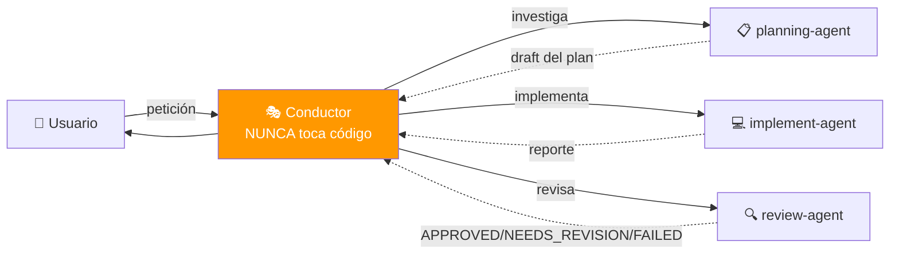

# NEXUS Landing Page — AGENTS.md

## Visión General



**Principio:** El Conductor COORDINA. Los subagentes EJECUTAN. La firma `🤖 [<agent>] ...` confirma qué subagente respondió.

---

## Reglas de Oro del Conductor

| El Conductor (esta skill) | Los Subagentes |
|---------------------------|----------------|
| ✅ Planifica y coordina | ✅ Ejecutan trabajo concreto |
| ✅ Escribe en `plans/*.md` | ✅ planning-agent: investiga + draft |
| ✅ Actualiza TodoWrite | ✅ implement-agent: código y tests |
| ✅ Anuncia delegaciones | ✅ review-agent: verdicto APPROVED/... |
| ❌ **NUNCA** Read/Grep/Edit sobre código | ❌ No tocan planes ni docs de coordinación |
| ❌ **NUNCA** ejecuta Bash sobre el repo | ❌ No delegan a otros subagentes |

---

## Subagentes Registrados

| Subagente | Archivo | `subagent_type` | Firma de respuesta |
|-----------|---------|-----------------|---------------------|
| planning-agent | `.claude/agents/planning-agent.agent.md` | `planning-agent` | `🤖 [planning-agent] ...` |
| implement-agent | `.claude/agents/implement-agent.agent.md` | `implement-agent` | `🤖 [implement-agent] ...` |
| review-agent | `.claude/agents/review-agent.agent.md` | `review-agent` | `🤖 [review-agent] ...` |

---

## Skills Disponibles

| Skill | Trigger | Versión |
|-------|---------|---------|
| `subagent-pool` | "delegar", "orquestar", "conductor", "tarea compleja" | 4.0 |
| `arquitec-dev-ia` | crear AGENTS.md, skills, diagramas | — |

---

## Auto-invoke

| Acción del usuario | Skill |
|--------------------|-------|
| "usa el conductor para..." | `subagent-pool` |
| "delegar a..." | `subagent-pool` |
| "orquesta la separación / refactor / feature" | `subagent-pool` |
| "Fase 1:", "siguiente fase" | `subagent-pool` |

---

## Flujo de Trabajo

1. Conductor muestra **bloque de identidad** `🎭 CONDUCTOR ACTIVADO`
2. Conductor crea TodoWrite con fases iniciales
3. Conductor delega a `planning-agent` → recibe draft del plan
4. Conductor presenta plan al usuario → ⏸️ **PAUSA**
5. Usuario aprueba → Conductor escribe a `plans/{tarea}-plan.md`
6. Por cada fase:
   - `implement-agent` ejecuta → reporta
   - `review-agent` verifica → APPROVED / NEEDS_REVISION / FAILED
   - Si NEEDS_REVISION: re-delega a `implement-agent`
   - Conductor actualiza TodoWrite ✓
   - Conductor presenta resumen + commit msg → ⏸️ **PAUSA**
7. Conductor escribe `plans/{tarea}-complete.md`

---

## TODO siempre visible

```markdown
## Plan: {nombre}

### Estado
- [x] Fase 1: {título} ✅ APPROVED
- [🔄] Fase 2: {título} ← EN CURSO (delegado a implement-agent)
- [ ] Fase 3: {título}

🎭 Última acción: {qué acabo de hacer}
🎯 Siguiente: {qué viene}
```

---

## Convenciones del Proyecto

- **Idioma:** Español (código en inglés)
- **Stack:** HTML + CSS + JS vanilla (sin build, sin deps)
- **Pausas:** Tras plan y tras cada fase
- **Commits:** conventional commits (`feat:`, `fix:`, `refactor:`, ...)
- **TDD:** `implement-agent` escribe tests primero cuando aplica

---

## Recursos

- **Skill:** `.claude/skills/subagent-pool/SKILL.md`
- **Templates de prompts:** `.claude/skills/subagent-pool/assets/prompts.md`
- **Troubleshooting:** `.claude/skills/subagent-pool/assets/agent-definitions.md`
- **Agentes:** `.claude/agents/*.agent.md`
