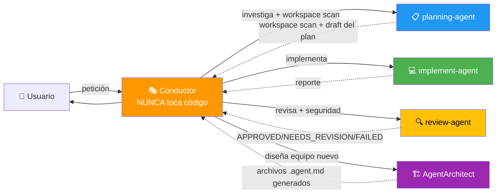

# Orquestacion Agentes Claude — AGENTS.md

## Visión General



**Principio:** El Conductor COORDINA. Los subagentes EJECUTAN. La firma `🤖 [<agent>] ...` confirma qué subagente respondió.

---

## Reglas de Oro del Conductor

| El Conductor (esta skill) | Los Subagentes |
|---------------------------|----------------|
| ✅ Planifica y coordina | ✅ Ejecutan trabajo concreto |
| ✅ Hace mini-entrevista (Q1, Q2, Q3) | ✅ planning-agent: workspace scan + draft |
| ✅ Escribe en `plans/*.md` | ✅ implement-agent: código y tests |
| ✅ Actualiza TodoWrite | ✅ review-agent: veredicto + seguridad |
| ✅ Anuncia delegaciones | ✅ AgentArchitect: genera nuevos agentes |
| ❌ **NUNCA** Read/Grep/Edit sobre código | ❌ No tocan planes ni docs de coordinación |
| ❌ **NUNCA** ejecuta Bash sobre el repo | ❌ No delegan a otros subagentes |

---

## Subagentes Registrados

| Subagente | Archivo | `subagent_type` | Modelo | Firma |
|-----------|---------|-----------------|--------|-------|
| planning-agent | `agents/planning-agent.agent.md` | `planning-agent` | sonnet | `🤖 [planning-agent] Investigando...` — usa graphify para grafo de conocimiento |
| implement-agent | `agents/implement-agent.agent.md` | `implement-agent` | sonnet | `🤖 [implement-agent] Ejecutando Fase {N}...` |
| review-agent | `agents/review-agent.agent.md` | `review-agent` | sonnet | `🤖 [review-agent] Revisando Fase {N}...` |
| AgentArchitect | `agents/AgentArchitect.agent.md` | `AgentArchitect` | opus | `🏗️ [AgentArchitect] Diseñando equipo...` |

---

## Skills Disponibles

| Skill | Trigger | Versión |
|-------|---------|---------|
| `subagent-pool` | "delegar", "orquestar", "conductor", "tarea compleja" | 5.0 |

---

## Auto-invoke

| Acción del usuario | Skill |
|--------------------|-------|
| "usa el conductor para..." | `subagent-pool` |
| "delegar a..." | `subagent-pool` |
| "orquesta la separación / refactor / feature" | `subagent-pool` |
| "Fase 1:", "siguiente fase" | `subagent-pool` |
| "diseña un equipo de agentes para..." | `subagent-pool` → `AgentArchitect` |

---

## Flujo de Trabajo v6.0 (con Graphify)

1. Conductor muestra **bloque de identidad** `🎭 CONDUCTOR ACTIVADO — v5.0`
2. Conductor hace **mini-entrevista** (Q1 proyecto, Q2 sub-dominios, Q3 pausas)
3. Conductor decide arquitectura (plana vs sub-coordinadores)
4. Conductor crea TodoWrite con fases iniciales
5. Conductor verifica estado de graphify (`ls graphify-out/graph.json`) e informa al planning-agent
6. Conductor delega a `planning-agent` → recibe workspace scan + graphify (god nodes, comunidades, queries) + draft del plan
7. Conductor presenta plan al usuario → ⏸️ **PAUSA**
8. Usuario aprueba → Conductor escribe a `plans/{tarea}-plan.md`
9. Por cada fase:
   - `implement-agent` ejecuta (recibe convenciones + advertencias del grafo: god nodes, dependencias) → reporta
   - `review-agent` verifica (criterios + convenciones + seguridad + god node impact) → APPROVED / NEEDS_REVISION / FAILED
   - Si NEEDS_REVISION: re-delega a `implement-agent`
   - Conductor actualiza TodoWrite ✓
   - Conductor presenta resumen + commit msg → ⏸️ **PAUSA**
9. Conductor escribe `plans/{tarea}-complete.md`

---

## TODO siempre visible

```markdown
## Plan: {nombre}

### Estado
- [x] Fase 0: Workspace scan + investigación ✅
- [x] Fase 1: {título} ✅ APPROVED
- [🔄] Fase 2: {título} ← EN CURSO (delegado a implement-agent)
- [ ] Fase 3: {título}

🎭 Última acción: {qué acabo de hacer}
🎯 Siguiente: {qué viene}
```

---

## Recursos

- **Skill:** `skills/subagent-pool/SKILL.md`
- **Templates de prompts:** `skills/subagent-pool/assets/prompts.md`
- **Definiciones + troubleshooting:** `skills/subagent-pool/assets/agent-definitions.md`
- **Protocolo de entrevista completo:** `skills/subagent-pool/assets/interview-protocol.md`
- **Agentes:** `agents/*.agent.md`
