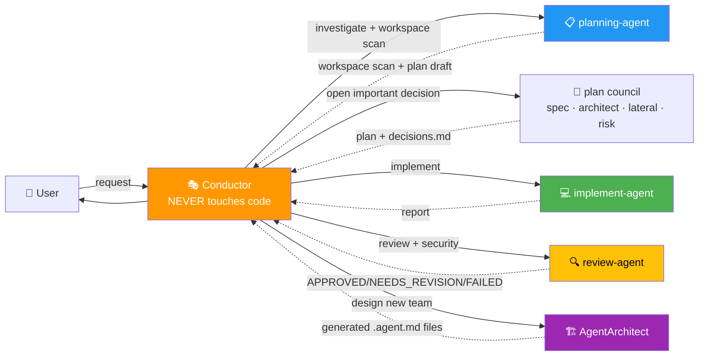

# Orquestacion Agentes Claude — AGENTS.md

> **Installing this stack?** Follow [INSTALL.md](INSTALL.md). It covers the installer, backups, settings merge, add-ons and the restart.

## Overview



**Principle:** The Conductor COORDINATES. Subagents EXECUTE. The signature `🤖 [<agent>] ...` confirms which subagent responded.

---

## Conductor Golden Rules

| The Conductor (this skill) | The Subagents |
|---------------------------|---------------|
| ✅ Plans and coordinates | ✅ Execute concrete work |
| ✅ Asks only what changes the plan (max 3, each with a default) | ✅ planning-agent: workspace scan + draft |
| ✅ Writes in `plans/*.md` | ✅ implement-agent: code and tests |
| ✅ Updates TodoWrite | ✅ review-agent: verdict + security |
| ✅ Announces delegations | ✅ AgentArchitect: generates new agents |
| ❌ **NEVER** Read/Grep/Edit on code | ❌ Don't touch plans or coordination docs |
| ❌ **NEVER** runs Bash on the repo | ❌ Don't spawn subagents (council members only message each other) |

---

## Language Policy

| Agent | Language |
|-------|----------|
| **Conductor** | User's language (detects from first message) |
| planning-agent | English |
| implement-agent | English |
| review-agent | English |
| AgentArchitect | English |

---

## Registered Subagents

| Subagent | File | `subagent_type` | Model | Signature |
|----------|------|-----------------|-------|-----------|
| planning-agent | `agents/planning-agent.agent.md` | `planning-agent` | sonnet | `🤖 [planning-agent] Investigating...` — uses graphify for knowledge graph |
| implement-agent | `agents/implement-agent.agent.md` | `implement-agent` | haiku | `🤖 [implement-agent] Running Phase {N}...` |
| review-agent | `agents/review-agent.agent.md` | `review-agent` | sonnet | `🤖 [review-agent] Reviewing Phase {N}...` |
| council-spec | `agents/council-spec.agent.md` | `council-spec` | sonnet | `🧭 [council-spec]` — acceptance criteria |
| council-architect | `agents/council-architect.agent.md` | `council-architect` | sonnet | `🏛️ [council-architect]` — phases + final synthesis |
| council-lateral | `agents/council-lateral.agent.md` | `council-lateral` | sonnet | `🌀 [council-lateral]` — the non-obvious option (asks Codex) |
| council-risk | `agents/council-risk.agent.md` | `council-risk` | sonnet | `⚠️ [council-risk]` — risks and verification |
| AgentArchitect | `agents/AgentArchitect.agent.md` | `AgentArchitect` | opus | `🏗️ [AgentArchitect] Designing team...` |
| codex-agent (optional) | `agents/optional/codex-agent.agent.md` | `codex-agent` | per mode (registry) | `🤖 [codex-agent] mode=<mode> model=<model>` — only if you use Codex; see SKILL §10b |

---

## Available Skills

| Skill | Trigger | Version |
|-------|---------|---------|
| `subagent-pool` | "delegate", "orchestrate", "conductor", "complex task" | 9.13 |
| `arquitec-dev-ia` | "create AGENTS.md", "document architecture", "structure for AI", "output style", "add rules", "prepare for orchestration" | 5.0 |
| `graphify` | `/graphify` | — |

---

## Auto-invoke

| User action | Skill |
|-------------|-------|
| "use the conductor for..." | `subagent-pool` |
| "delegate to..." | `subagent-pool` |
| "orchestrate the separation / refactor / feature" | `subagent-pool` |
| "Phase 1:", "next phase" | `subagent-pool` |
| "design an agent team for..." | `subagent-pool` → `AgentArchitect` |

---

## Workflow v9.13

1. Conductor reads `.claude/project-context.md` (HALT and suggest `arquitec-dev-ia` if missing); offers to resume an unfinished `plans/*-state.md`
2. Admission and triage: the mandatory first line for tier M/L is `Tier {S|M|L} · {operation} · {single|duo|council} · urgency {low|normal|high} · uncertainty {low|med|high} · risk {low|med|high} — {one-clause reason}`, e.g. `Tier M · fix · single · urgency normal · uncertainty high · risk low — cause unknown, auth module untouched`; tier S is `Tier S · fix — direct`; urgency never removes controls; the user can override it
3. Asks only questions that change the plan (max 3, each with a default); states other assumptions
4. Case flow (`skills/subagent-pool/SKILL.md` §2b): diagnosis by `planning-agent` (facts · hypotheses · evidence · missing · proposed intervention · falsifier) → consult one specialist (review-agent `mode=consult specialty=<x>`, or planning-agent for code facts), or the council **only when an open important decision remains** (duo for an open non-important choice or a vague spec; single otherwise) → plan (council protocol: `skills/subagent-pool/assets/council.md`). Security, API, data and money raise the risk axis; they never convene the council alone
5. The plan lands in `plans/{task}-draft.md` → ⏸️ **PAUSE** for approval
6. Per phase: `implement-agent` → `review-agent` (contract-first + independent check); a NEEDS_REVISION routes by `FAILURE_ORIGIN` (implementation → implement-agent, max 2 loops; diagnosis → planning-agent; scope → re-triage); 3 re-routes per case in total, then the user decides
   - FAILED → consult the user first
   - A NEEDS_REVISION finding is binding: the Conductor never drops, downgrades or defers it on its own; it re-delegates per FAILURE_ORIGIN or asks the user, who may accept it as a recorded risk
   - Approve-tier actions (delete, migrate, secrets, push/publish/deploy) → BLOCKED until the user approves
   - checkpoint `plans/{task}-state.md` (the case file); pause only on god nodes, approve-tier actions, FAILED or user request
7. Close: VERIFIED, not DEPLOYED. The final report lists changed · verified · not done/risks · commit message; closing never authorizes publish or deploy

Models: each agent's `model:` frontmatter decides; the Conductor never overrides it unless the user asks.

---

## Plan status (shown at pauses and at the end)

```markdown
## Plan: {name}

### Status
- [x] Phase 0: Workspace scan + investigation ✅
- [x] Phase 1: {title} ✅ APPROVED
- [🔄] Phase 2: {title} ← IN PROGRESS (delegated to implement-agent)
- [ ] Phase 3: {title}

🎭 Last action: {what I just did}
🎯 Next: {what comes next}
```

---

## Resources

- **Skill (orchestration):** `skills/subagent-pool/SKILL.md`
- **Skill (documentation):** `skills/arquitec-dev-ia/SKILL.md`
- **Project context template:** `skills/arquitec-dev-ia/assets/template_project_context.md`
- **Prompt templates:** `skills/subagent-pool/assets/prompts.md`
- **Definitions + troubleshooting:** `skills/subagent-pool/assets/agent-definitions.md`
- **Full interview protocol:** `skills/subagent-pool/assets/interview-protocol.md`
- **Visualizer (separate repo):** [Agent Hospital](https://github.com/elisaul77/agent-hospital) — read-only pixel-art view of the agents working live
- **Plan council protocol:** `skills/subagent-pool/assets/council.md`
- **Agents:** `agents/*.agent.md`
