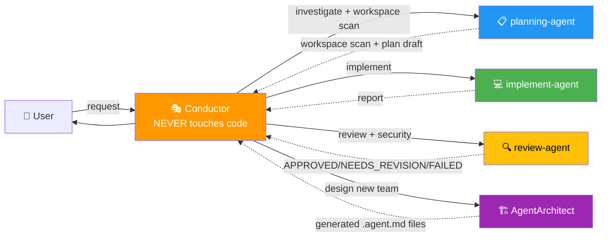

# Orquestacion Agentes Claude — AGENTS.md

## Overview



**Principle:** The Conductor COORDINATES. Subagents EXECUTE. The signature `🤖 [<agent>] ...` confirms which subagent responded.

---

## Conductor Golden Rules

| The Conductor (this skill) | The Subagents |
|---------------------------|---------------|
| ✅ Plans and coordinates | ✅ Execute concrete work |
| ✅ Runs mini-interview (Q1, Q2, Q3) | ✅ planning-agent: workspace scan + draft |
| ✅ Writes in `plans/*.md` | ✅ implement-agent: code and tests |
| ✅ Updates TodoWrite | ✅ review-agent: verdict + security |
| ✅ Announces delegations | ✅ AgentArchitect: generates new agents |
| ❌ **NEVER** Read/Grep/Edit on code | ❌ Don't touch plans or coordination docs |
| ❌ **NEVER** runs Bash on the repo | ❌ Don't delegate to other subagents |

---

## Language Policy

| Agent | Language |
|-------|----------|
| **Conductor** | User's language (detects from first message) |
| planning-agent | English |
| implement-agent | English |
| review-agent | English |
| AgentArchitect | English |

---

## Registered Subagents

| Subagent | File | `subagent_type` | Model | Signature |
|----------|------|-----------------|-------|-----------|
| planning-agent | `agents/planning-agent.agent.md` | `planning-agent` | sonnet | `🤖 [planning-agent] Investigating...` — uses graphify for knowledge graph |
| implement-agent | `agents/implement-agent.agent.md` | `implement-agent` | sonnet | `🤖 [implement-agent] Running Phase {N}...` |
| review-agent | `agents/review-agent.agent.md` | `review-agent` | sonnet | `🤖 [review-agent] Reviewing Phase {N}...` |
| AgentArchitect | `agents/AgentArchitect.agent.md` | `AgentArchitect` | opus | `🏗️ [AgentArchitect] Designing team...` |

---

## Available Skills

| Skill | Trigger | Version |
|-------|---------|---------|
| `subagent-pool` | "delegate", "orchestrate", "conductor", "complex task" | 8.0 |
| `arquitec-dev-ia` | "create AGENTS.md", "document architecture", "structure for AI", "output style", "add rules", "prepare for orchestration" | 5.0 |
| `graphify` | `/graphify` | — |

---

## Auto-invoke

| User action | Skill |
|-------------|-------|
| "use the conductor for..." | `subagent-pool` |
| "delegate to..." | `subagent-pool` |
| "orchestrate the separation / refactor / feature" | `subagent-pool` |
| "Phase 1:", "next phase" | `subagent-pool` |
| "design an agent team for..." | `subagent-pool` → `AgentArchitect` |

---

## Workflow v8.0 (with Graphify + Project Context Validation)

1. Conductor shows **identity block** `🎭 CONDUCTOR ACTIVATED — v8.0`
2. Conductor reads `.claude/project-context.md` → **HALT if missing** (suggest `arquitec-dev-ia` first)
3. Conductor runs **mini-interview** (Q1 project, Q2 sub-domains, Q3 pauses)
4. Conductor decides architecture (flat vs sub-coordinators)
5. Conductor creates TodoWrite with initial phases
6. Conductor delegates to `planning-agent` with pre-context (stack, god nodes, communities, graphify status from project-context.md)
7. `planning-agent` validates/extends the context with workspace scan + graphify → plan draft
8. Conductor presents plan to user → ⏸️ **PAUSE**
9. User approves → Conductor writes to `plans/{task}-plan.md`
10. Per each phase:
    - `implement-agent` executes (receives conventions + god node warnings from project-context.md + planning-agent) → reports
   - `review-agent` verifies (criteria + conventions + security + god node impact) → APPROVED / NEEDS_REVISION / FAILED
   - If NEEDS_REVISION: re-delegates to `implement-agent`
   - Conductor updates TodoWrite ✓
   - Conductor presents summary + commit msg → ⏸️ **PAUSE**
10. Conductor writes `plans/{task}-complete.md`

---

## Always-visible TODO

```markdown
## Plan: {name}

### Status
- [x] Phase 0: Workspace scan + investigation ✅
- [x] Phase 1: {title} ✅ APPROVED
- [🔄] Phase 2: {title} ← IN PROGRESS (delegated to implement-agent)
- [ ] Phase 3: {title}

🎭 Last action: {what I just did}
🎯 Next: {what comes next}
```

---

## Resources

- **Skill (orchestration):** `skills/subagent-pool/SKILL.md`
- **Skill (documentation):** `skills/arquitec-dev-ia/SKILL.md`
- **Project context template:** `skills/arquitec-dev-ia/assets/template_project_context.md`
- **Prompt templates:** `skills/subagent-pool/assets/prompts.md`
- **Definitions + troubleshooting:** `skills/subagent-pool/assets/agent-definitions.md`
- **Full interview protocol:** `skills/subagent-pool/assets/interview-protocol.md`
- **Agents:** `agents/*.agent.md`
