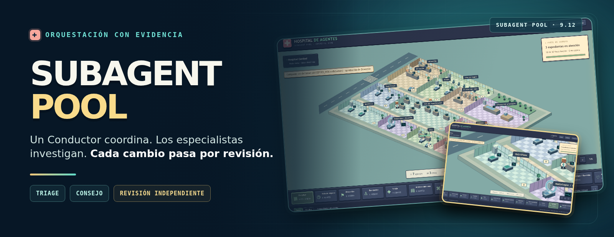
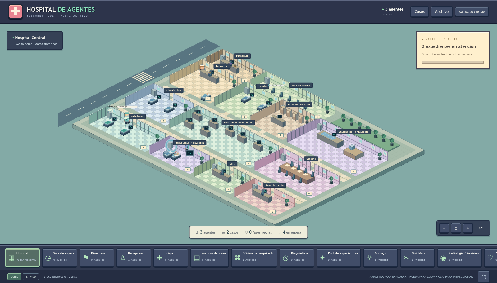

# 🤖 Orquestacion Agentes Claude



🌐 **English** · [Español](README.es.md)

[](https://opensource.org/licenses/MIT)
[](CHANGELOG.md)
[](#-tests)
[](https://claude.com/claude-code)
[](#optional-add-ons)

[](https://github.com/sponsors/elisaul77)
[](https://paypal.me/eflorezp)
[](https://buymeacoffee.com/elisaul77)

**A Conductor for Claude Code: it plans, delegates to specialist subagents and has every phase reviewed by another agent.**
For complex work (3 or more files, a new module, a refactor). You approve the plan; nothing irreversible happens without you.

```
you ──> Conductor (scopes and delegates, never touches code)
          │
          ├─ plan ──────► planning-agent                      (simple plans)
          │               or plan council: spec · architect   (an open important decision)
          │                  · lateral · risk, debating
          │                         │
          │                  plans/*.md ──► your approval
          │
          ├─ per phase ─► implement-agent ──► review-agent ──► APPROVED | NEEDS_REVISION
          │                                       ▲
          │                     codex-agent ──────┘  second-vendor review (optional)
          │
          ├─ new domain ► AgentArchitect ──► new specialist team
          └─ outside skill ► isolated review ──► private library (by path)
```

---

## 🚀 Getting started

### Install

```bash
git clone https://github.com/elisaul77/Orquestacion_Agentes_claude.git
cd Orquestacion_Agentes_claude

python3 skills/subagent-pool/scripts/install.py --dry-run          # preview, changes nothing
python3 skills/subagent-pool/scripts/install.py --with teams       # core + the add-ons you choose
```

The installer backs up what is installed, copies the skills and agents, **merges** `settings.json` (never overwrites it), and ends with doctor's checks. Add-ons: `teams`, `cost-hook`, `codex`, `claude-md` (see the table below). It is safe to re-run for updates.

> 🤖 **An agent installing this?** Point it to [INSTALL.md](INSTALL.md): it asks you about the add-ons, installs, and hands over.

Restart Claude Code (agent files load when a session starts), then check the install:

```bash
python3 ~/.claude/skills/subagent-pool/scripts/doctor.py
```

`doctor` is read-only. It checks the skill version, the agents, the optional add-ons, and SSH remotes if you pass `--remote host`. Every failed check comes with the command that fixes it.

<details>
<summary>Without git: core install with curl</summary>

```bash
BASE=https://raw.githubusercontent.com/elisaul77/Orquestacion_Agentes_claude/master
for skill in subagent-pool arquitec-dev-ia graphify; do
  mkdir -p ~/.claude/skills/${skill}
  curl -sSL "$BASE/skills/${skill}/SKILL.md" -o ~/.claude/skills/${skill}/SKILL.md
done
mkdir -p ~/.claude/skills/subagent-pool/assets
for f in prompts research interview-protocol agent-definitions council; do
  curl -sSL "$BASE/skills/subagent-pool/assets/${f}.md" -o ~/.claude/skills/subagent-pool/assets/${f}.md
done
mkdir -p ~/.claude/agents
for agent in planning-agent implement-agent review-agent AgentArchitect \
             council-spec council-architect council-lateral council-risk; do
  curl -sSL "$BASE/agents/${agent}.agent.md" -o ~/.claude/agents/${agent}.agent.md
done
```

This installs no scripts (doctor, cost ledger, skill review), and `arquitec-dev-ia` comes without its `assets/`. Use `git clone` for the full install.

</details>

### Requirements

- [Claude Code](https://claude.com/claude-code) and a `~/.claude/` folder.
- Python 3.10+ for the scripts. They use the standard library only.
- Recommended: `.claude/project-context.md` in your project. If it is missing, the Conductor suggests running `arquitec-dev-ia` first.

### Optional add-ons

Each one is independent; without any of them the skill runs on Claude alone.

| Add-on | What it adds | How |
|---|---|---|
| **Agent teams** | Council members debate each other directly instead of through files | Add `"env": {"CLAUDE_CODE_EXPERIMENTAL_AGENT_TEAMS": "1"}` to `~/.claude/settings.json` (experimental Claude Code flag) |
| **Codex** | Second-vendor review, implementation and coordination; the council's lateral thinker asks Codex too | `npm i -g @openai/codex && codex login`, then `cp agents/optional/codex-agent.agent.md ~/.claude/agents/` |
| **[graphify](https://github.com/safishamsi/graphify)** | `planning-agent` maps central nodes and dependencies before planning (repos over ~20 files) | `uv tool install graphifyy && graphify install` (the PyPI package is `graphifyy`) |
| **Cost ledger** | Tokens per session and per model, including subagents | `Stop` hook from [hooks.md](skills/subagent-pool/assets/hooks.md); report with `cost_tracker.py report` |

---

## 🎯 Using it

Ask in plain language: `use the conductor to…`, `delegate to subagents`, `complex task: …`, or simply describe a feature or refactor. To design a new team: `design an agent team for…`.

Before planning, the Conductor states its reading of the task in one line:

```
Tier M · fix · single · urgency normal · uncertainty high · risk low — cause unknown, auth module untouched
```

- **Tier** is the effort (S, M or L).
- **Operation** is feature, fix, tweak or refactor. Each one has a mandatory first move; a fix, for example, starts with a failing test.
- **Plan level** is who writes the plan: single, duo or council.
- **Urgency, uncertainty and risk** are three more axes. Urgency sets priority and never removes controls; uncertainty sets how much to investigate; risk sets how much specialist review.
- The line is the Conductor's mandatory first line for tier M and L. Tier S gets one line instead: `Tier S · fix — direct`.

If you disagree, say so and that wins: `a single planner is enough`, `use the council for the plan`, `do it directly`. Nothing else needs configuring.

What you are asked to decide:

1. **Questions that change the plan.** At most 3, each with a proposed default.
2. **The plan.** At the council level it comes with a decision record (`decisions.md`) and any open disagreements.
3. **Approve-tier actions** (delete, migrate, secrets, push, publish, deploy), when they come up.
4. **The commit**, at the end.

An interrupted task resumes from `plans/{task}-state.md`, and the Conductor offers to continue it.

---

## 🏥 See the agents at work

**[Agent Hospital](https://github.com/elisaul77/agent-hospital)** is a read-only isometric view of **Claude Code and Codex** activity. Each agent is a character. A confirmed subagent-pool session opens the full hospital: reception, waiting room, diagnosis, operating room, review, council, direction, archive and discharge. With another skill, it shows the rooms relevant to observed activity. The council is convened for open important decisions; the two-step desk-to-table animation is planned for a later version. The viewer never runs or steers agents.



```bash
git clone https://github.com/elisaul77/agent-hospital && cd agent-hospital
docker compose up -d --build
# Full demo: http://127.0.0.1:8700/?mode=demo
docker compose -f docker-compose.yml -f compose.live.yml up -d --build
# Real sessions: http://127.0.0.1:8700/?mode=live
```

Live mode mounts transcripts and case files read-only. In Codex, this skill writes `Hospital session: codex-<CODEX_THREAD_ID>` in the case file when the real ID is available; the viewer also requires observed subagent evidence before opening the full hospital. [See the hospital GIF and guide](https://github.com/elisaul77/agent-hospital).

---

## 🤔 What it is and what it isn't

**It is not a framework.** It is Markdown files (skills and agents) that Claude Code loads, plus a few standard-library Python scripts. There is no server and no runtime.

**It is not for one file.** Orchestration costs several times the tokens of a single agent, so small tasks are done directly.

**It does not decide for you.** You approve the plan and every irreversible action. After two failed review loops the Conductor stops and asks instead of insisting.

**Codex is optional and never replaces Claude Code.** The whole flow runs inside Claude Code; Codex is a second opinion.

---

## 👥 The team

| Agent | Role | Writes project code |
|---|---|---|
| **Conductor** (the `subagent-pool` skill) | Scopes, picks the effort, delegates, talks to you | ❌ never |
| `planning-agent` | Scans the repo (graphify if present) and writes a phased plan | ❌ |
| `council-spec` | Council: what "done" means, as testable criteria | ❌ |
| `council-architect` | Council: phases over the real files; writes the final plan | ❌ |
| `council-lateral` | Council: the non-obvious option (don't build it, half the parts, a false assumption) — asks Codex, or Opus without Codex *(experimental — written and reviewed, not yet measured in real runs)* | ❌ |
| `council-risk` | Council: what breaks, and how each claim will be proven | ❌ |
| `implement-agent` | Implements one phase, test first | ✅ the only one |
| `review-agent` | APPROVED / NEEDS_REVISION / FAILED, with evidence per criterion | ❌ |
| `AgentArchitect` | Designs and generates specialist teams for new domains | ❌ (writes agent files) |
| `codex-agent` *(optional)* | Bridge to Codex: plan, implement, review, debug, browser, coordinate | sandboxed |

Each agent's model is set in its own file (`model:`), and you decide it. The Conductor never overrides it.

---

## 🔄 How a task flows

**1. Admission and four-axis triage.** The Conductor states the objective and what success looks like, then scores four separate axes: **urgency** (priority; it never removes controls), **effort** (S, M or L, below), **uncertainty** (investigate, consult or compare alternatives) and **risk** (controls and specialist review). Tier S is done directly, with no case file. For M and L the case file is `plans/{task}-state.md`. If the diagnosis changes the scope or the risk, the Conductor re-triages.

| Tier | Signal | Flow |
|---|---|---|
| S | 1–2 files, clear fix | Done directly, no orchestration |
| M | 3–6 files, one area | Plan, then implement and review per phase |
| L | New module, cross-component refactor, design choice | The same; the plan level decides who writes the plan |

**2. Diagnosis with a falsifier.** `planning-agent`, in Diagnosis mode, returns facts, hypotheses, evidence, what is missing (project, specialist or user), the proposed intervention and a **falsifier**: the hypothesis plus the observation (a command and its expected result) that would disprove it. Two rounds without new evidence stop the loop.

**3. Consult, or plan.** A **consult** is one specialist answering one bounded question (review-agent `mode=consult specialty=<x>`, or planning-agent for code facts) *(experimental — written and reviewed, not yet measured in real runs)*. A **council** runs only when an **open important decision** remains after diagnosis.

| Plan level | When | Who |
|---|---|---|
| single | Clear approach: Tier M, or Tier L with no open important decision | `planning-agent` |
| duo | An open choice that is not important, or a vague request | architect + lateral, blind drafts, architect synthesizes |
| council | An open important decision remains after diagnosis | the four members, with a debate round |

Sensitive changes (security, a public API, data, money) raise the **risk** axis: they get a specialist review, and they never convene the council by themselves.

```
council   R1  blind drafts ── spec · architect · lateral · risk (nobody reads anyone)
          R2a objections   ── sent directly between members, logged in debate.log
          R2b replies      ── each answers what was objected to them
          R3  synthesis    ── architect: plans/{task}-draft.md + decisions.md
```

The Conductor only signals the rounds; the debate content never passes through it. Without the agent-teams flag the same rounds run through files. Full protocol: [council.md](skills/subagent-pool/assets/council.md).

**4. Per phase, routed by origin.** `implement-agent` → `review-agent`, plus a Codex review in parallel if Codex is on. A NEEDS_REVISION also names a `FAILURE_ORIGIN`, and the Conductor routes the fix by it:

```
review ─► FAILURE_ORIGIN ─► implementation → implement-agent (max 2 loops per phase)
                         ─► diagnosis      → planning-agent, citing the falsifier
                         ─► scope          → re-triage
                         (3 re-routes per case in total, then you decide)
```

*Routing by origin (`FAILURE_ORIGIN` and its re-routes): experimental — written and reviewed, not yet measured in real runs.* A finding in a NEEDS_REVISION is binding: the Conductor never drops, downgrades or defers it on its own. It re-delegates it or asks you, and you may accept it as a recorded risk.

FAILED goes to you first. A checkpoint goes to `plans/{task}-state.md` after every approved phase.

**5. Close: verified, not deployed.** A final report covering what changed, what was verified, what wasn't, and the risks. Closing a case means it is verified. It never authorizes a publish or a deploy, which stay approve-tier. The commit waits for your OK.

---

## 🧠 The ten non-obvious things

### 1. The plan is a team decision, and the team must not agree too early

Agents from the same model that see each other's ideas converge on one answer. So council drafts are blind, there is a single debate round with hard limits, and every lateral proposal ends up in `decisions.md`, kept or not, for you to overrule.

### 2. Effort scales with the task

A multi-agent system spends about 15× the tokens of a chat. Orchestrating something small is a mistake, not rigor.

### 3. Fork or fresh subagent: the context size decides

A fork inherits the Conductor's context. Below **~75k tokens** it costs about 50 % less than a fresh subagent; above that it costs about 2× more. Accuracy didn't change in our tests.

### 4. The Conductor can run on Sonnet

On a task with 19 hidden criteria, Sonnet matched Opus at **−39 % cost**. Opus pays off for tier L design choices.

### 5. No `/advisor` with this skill

The advisor re-reads the whole conversation uncached on every call, and every subagent inherits it. Sonnet with an Opus advisor cost **+150 %**, with the same accuracy and erratic delegation.

### 6. "Avoid the predictable" raises originality

Across 290 generations, explicitly asking to avoid the first idea raised originality by **+2.00 (Sonnet) and +2.80 (Opus)**. Praise or insults didn't help. Every creative prompt in the skill carries that line.

### 7. A claim needs evidence, and its level is written down

Every acceptance criterion is marked `[OBSERVED]`, `[DERIVED]`, `[INFERRED]` or `[UNKNOWN]`. Behavior counts as met only when someone ran it and saw the result. Agents also list what they did **not** verify.

### 8. Codex never reviews Codex

An LLM judge tends to prefer its own text ([arXiv 2410.21819](https://arxiv.org/abs/2410.21819)), so review always crosses vendors. Model slugs aren't hardcoded either: the latest version per family is read from the local Codex cache.

### 9. Codex can nest agents; Claude subagents can't

Claude subagents have no tool to spawn agents. A Codex session can, so `codex-agent mode=coordinate` fans independent phases out inside Codex, using roles synced from our agent files, and Claude still reviews every phase. New Claude agents load only after a restart; new Codex roles are usable at once.

### 10. The main model never reads an outside skill

Third-party skills are reviewed in two isolated containers: an offline pre-scan, then a reviewer whose only exit is an allow-list proxy. You approve each run, with its cost estimate. The Conductor receives only the verdict and the report path.

---

## 📊 Measured, not estimated

Measurements on test tasks, from [`research.md`](skills/subagent-pool/assets/research.md) and the [CHANGELOG](CHANGELOG.md). They are not guarantees for your project.

| Measure | Result | Detail |
|---|---|---|
| Same prompt in English vs Spanish | **−30 %** input tokens | [research](skills/subagent-pool/assets/research.md#language-and-tokens-own-measurement-2026-10-10) |
| Fork vs fresh subagent | Fork ~50 % cheaper under ~75k context, ~2× above; same accuracy | [research](skills/subagent-pool/assets/research.md#fork-vs-fresh-subagent-own-measurement-2026-10-10) |
| Conductor Sonnet vs Opus | 19/19 on both; **−39 %** cost (n = 5) | [research](skills/subagent-pool/assets/research.md#conductor-model-and-the-advisor-tool-own-measurement-2026-10-11) |
| `/advisor` on top of Sonnet | **+150 %** cost, same accuracy | [research](skills/subagent-pool/assets/research.md#conductor-model-and-the-advisor-tool-own-measurement-2026-10-11) |
| "Avoid the predictable" | **+2.00** Sonnet (p = .005), **+2.80** Opus (p < .001); 290 samples | [research](skills/subagent-pool/assets/research.md#own-experiment-2026-10-0910-spelling-and-tone-vs-creativity) |
| Multi-agent vs chat | ~15× tokens (Anthropic reference) | [research §2](skills/subagent-pool/assets/research.md#2-effort-scaling-and-multi-agent-cost) |

The council's cost (about +4–6× a single plan) is still an estimate; see [What's missing](#%EF%B8%8F-whats-missing).

### What was measured

- **A/B bench** (`competition/`): 10 valid runs of 12 run dirs, equal outcomes between the versions. Every run is listed in [competition/RESULTS.md](competition/RESULTS.md). In one run v9.10 ignored a NEEDS_REVISION, which led to the binding-review rule (v9.12).
- **Real use** (a Forja project and the Hospital case): the WARNINGS block, the no-git rule for the Conductor and the explicit-orchestration line (v9.12) come from there.
- **Not measured yet:** FAILURE_ORIGIN routing, re-routes, consult and the lateral's second voice. They are experimental (labelled above).

---

## 🧪 Tests

```bash
python3 -B -m unittest discover -s skills/subagent-pool/scripts
```

**228 tests**, standard library only. Two are skipped on Python < 3.11 because they need `tomllib`.

| File | Tests | Covers |
|---|---|---|
| `test_skills_lib.py` | 103 | Reviewed-skills library: schema, veto rules, lookup, re-review on source change |
| `test_codex_models.py` | 15 | Codex model registry: version order, missing, corrupt or stale cache |
| `test_skill_prescan.py` | 13 | Offline pre-scan over a benign and a malicious fixture |
| `test_trim_output.py` | 12 | Test-output trimming never drops a failure line (real unittest/pytest output) |
| `test_cost_tracker.py` | 9 | Cost ledger: dedup of streamed ids, subagents, report |
| `test_install.py` | 14 | Installer: dry run, settings merge without overwrite, backup, CLAUDE.md block, Codex add-on |
| `test_doctor.py` | 10 | Install health check: drift, remotes, Codex roles, council, teams flag |
| `test_sync_codex_agents.py` | 9 | Agent → Codex role sync: TOML escaping, YAML blocks, foreign files |
| `test_instincts.py` | 4 | Per-project lessons store |
| `test_mutate.py` | 4 | Mutation check runs in an isolated copy |
| `test_council.py` | 5 | Council agents have `SendMessage`, and the protocol matches the skill |
| `test_caseflow.py` | 30 | Case flow rules are written (structural only — not routing behavior) |

`skill-review.sh` has no automated tests; its `--dry-run` prints every command without running it.

---

## 🔒 Security

- **Approval tiers.** Edits inside the approved scope and tests are automatic. Anything outside it is reported. Delete, migrate, secrets, push, publish and deploy come back as `BLOCKED` until you approve them.
- **Codex** runs sandboxed (`read-only`, `workspace-write` at most). The council's lateral member only calls Codex (`read-only`) or Opus (no tools).
- **Outside skills** are fetched from official sources only (`anthropics/skills`, `openai/skills`, `vercel-labs/agent-skills`) and reviewed in two containers:
  - Pre-scan: `--network none`, the skill mounted read-only.
  - Reviewer: its only exit is a squid allow-list proxy to the model API.
  - Both run with `--read-only`, `--cap-drop ALL`, `no-new-privileges`, a non-root user, and memory and process limits.
  - Any doubt (symlinks, opaque files, a truncated pre-scan) turns APPROVED into DOUBTFUL.

**Accepted residual risk:** the reviewer holds a read-only credential next to untrusted text. Use a dedicated, scoped key. Details in [skills-library.md](skills/subagent-pool/assets/skills-library.md).

---

## 📁 Structure

```
Orquestacion_Agentes_claude/
├── AGENTS.md · INSTALL.md · CHANGELOG.md · LICENSE · FUNDING.md
├── README.md · README.es.md · docs/banner.png
├── agents/
│   ├── planning-agent.agent.md        # Phased plan (graphify)
│   ├── implement-agent.agent.md       # Code and tests, one phase at a time
│   ├── review-agent.agent.md          # Verdict with evidence levels
│   ├── council-spec.agent.md          # Council: acceptance criteria
│   ├── council-architect.agent.md     # Council: phases + final synthesis
│   ├── council-lateral.agent.md       # Council: the non-obvious option (asks Codex, or Opus without Codex)
│   ├── council-risk.agent.md          # Council: risks and verification
│   ├── AgentArchitect.agent.md        # Designs new specialist teams
│   └── optional/codex-agent.agent.md  # Bridge to OpenAI Codex
└── skills/
    ├── subagent-pool/                 # The Conductor
    │   ├── SKILL.md
    │   ├── assets/
    │   │   ├── prompts.md             # Templates and return contracts
    │   │   ├── council.md             # Plan council protocol
    │   │   ├── agent-definitions.md · interview-protocol.md
    │   │   ├── research.md            # Evidence behind each rule
    │   │   ├── hooks.md               # Optional cost-ledger hook
    │   │   ├── codex-modes.md · codex-verdict.schema.json
    │   │   ├── skills-library.md · skill-review-prompt.md · official-sources.json
    │   │   └── skills-probadas-template/
    │   └── scripts/
    │       ├── install.py             # Installer (backup, merge, add-ons)
│       ├── doctor.py              # Read-only install health check
    │       ├── trim_output.py         # Shrinks test output, keeps every failure
    │       ├── cost_tracker.py        # Token ledger (Stop hook) and report
    │       ├── instincts.py           # Per-project lessons
    │       ├── mutate.py              # Do the tests catch injected bugs?
    │       ├── sync_codex_agents.py   # Agents → Codex roles
    │       ├── codex-models.py        # Latest Codex model per family
    │       ├── skills_lib.py · skill_prescan.py · skill-review.sh
    │       ├── test_*.py              # 228 tests
    │       └── fixtures/
    ├── arquitec-dev-ia/               # AI context docs; writes project-context.md
    └── graphify/                      # Knowledge-graph skill
```

---

## 📚 Documentation

| Document | Contents |
|---|---|
| [SKILL.md](skills/subagent-pool/SKILL.md) | The Conductor: tiers, plan levels, governance, flow, Codex, skill review |
| [council.md](skills/subagent-pool/assets/council.md) | Plan council: rounds, message limits, file-mode fallback |
| [prompts.md](skills/subagent-pool/assets/prompts.md) | Templates and return contracts for every agent |
| [agent-definitions.md](skills/subagent-pool/assets/agent-definitions.md) | Roles, tools, troubleshooting |
| [interview-protocol.md](skills/subagent-pool/assets/interview-protocol.md) | Designing new teams with AgentArchitect |
| [research.md](skills/subagent-pool/assets/research.md) | Evidence and sources behind each rule |
| [hooks.md](skills/subagent-pool/assets/hooks.md) | Cost-ledger hook |
| [codex-modes.md](skills/subagent-pool/assets/codex-modes.md) | Codex `debug` (Docker) and `browser` (Flatpak Chrome) recipes |
| [skills-library.md](skills/subagent-pool/assets/skills-library.md) | Reviewed-skills library and gated review |
| [CHANGELOG.md](CHANGELOG.md) | Version history |

---

## 🗺️ What's missing

- **Routing is not measured yet.** The A/B bench ran 10 valid runs with equal outcomes ([competition/RESULTS.md](competition/RESULTS.md)), but FAILURE_ORIGIN routing, re-routes and consult are experimental: written and reviewed, not yet measured in real runs. The case-flow tests check that the rules are written, not that a model follows them.
- **The council hasn't been measured on a real project yet.** We still need a run comparing a council plan with a single planner, and its real cost; +4–6× is an estimate.
- **Agent teams are an experimental Claude Code flag** and may change. If they do, the council falls back to file mode.
- **The container-2 reviewer hasn't run end to end** on a real skill.
- **`codex debug` inside Docker:** whether Codex can be reached from the container is unverified.
- **Model release dates:** the table in `skills-library.md` has `TODO` entries, so for now the freshness rule flags a candidate instead of discarding it.

---

## 🤝 Contributing

1. Fork the repo and create a branch (`feat/…`, `docs/…`).
2. Use commits in the form `type(scope): message`.
3. Run the tests before opening a PR.
4. Describe the change in the Pull Request.

Ideas welcome: specialist agents, usage examples, orchestration scenarios with tests. Report bugs in [GitHub Issues](https://github.com/elisaul77/Orquestacion_Agentes_claude/issues).

## 💖 Support the project

If it saves you time, star the repo, share it, and report what you find. Financial support options are in [FUNDING.md](FUNDING.md).

## 📄 License

MIT — see [LICENSE](LICENSE). Copyright (c) 2026 Elisaul Florez ([@elisaul77](https://github.com/elisaul77)).
