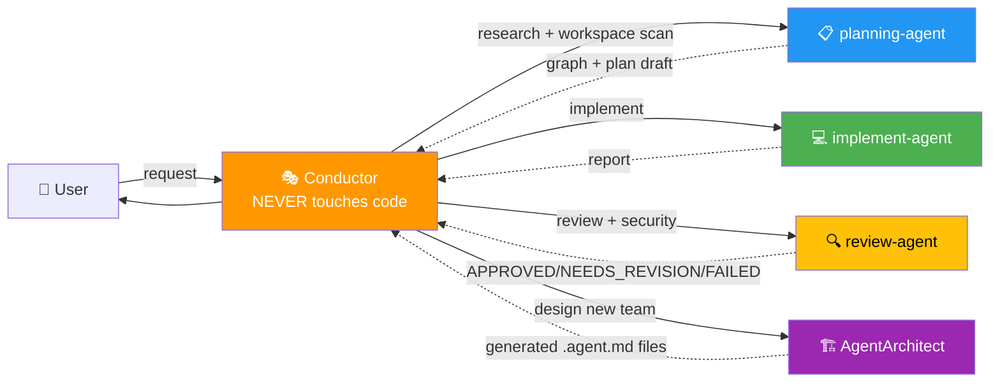

# Orquestacion Agentes Claude

> **Conductor + Subagents pattern for Claude Code** — local orchestration of complex tasks with built-in AI.

[](https://opensource.org/licenses/MIT)
[](https://claude.ai/code)
[](#️-architecture)
[](https://github.com/safishamsi/graphify)
[](https://github.com/sponsors/elisaul77)
[](https://paypal.me/eflorezp)
[](https://buymeacoffee.com/elisaul77)

🌐 **English** · [Español](README.es.md)

Multi-agent orchestration for **Claude Code** using the **Conductor + Subagents** pattern. The Conductor plans and coordinates; the subagents execute. Never the other way around.

---

## ✨ Key features

- 🎭 **Conductor pattern**: a central agent that plans, coordinates and never touches code
- 🤖 **Graphify built in**: `planning-agent` builds a knowledge graph of the project before planning
- 🔍 **Automatic review**: `review-agent` validates every phase (APPROVED / NEEDS\_REVISION / FAILED) with OWASP security criteria
- 🏗️ **AgentArchitect**: designs and generates new agent teams on the fly
- ⏸️ **Strategic pauses**: the Conductor shows you the plan before executing
- 📋 **Full traceability**: plans written to `plans/*.md`, progress visible in TodoWrite

### New in v9.0 — backed by 2025-2026 research

- 📏 **Effort scales with the task**: S/M/L tiers. Small work is not orchestrated (multi-agent costs ~15× tokens).
- 💡 **Divergent round (creativity)**: 2-3 isolated forks with distinct lenses return options with probabilities (*Verbalized Sampling*), never seeing each other, to avoid diversity collapse.
- 🛡️ **Action governance**: Auto / Notify / Approve tiers. Deleting, migrating, secrets, push, publishing or deploying always go through you. At most 2 review loops before escalating.
- 🧪 **Test integrity**: the implementer never weakens tests; the reviewer checks its diff and runs an independent check.
- 🗣️ **Communication**: outcome first, bad news stated plainly, calibrated confidence, ask only what changes the plan (each question with a default).
- 🪙 **Token savings**: the skill went from 667 to ~170 lines; templates in `assets/` (progressive disclosure); plans passed by file, not pasted.
- 🔀 **Fork or fresh subagent (v9.1, measured)**: forks are ~50 % cheaper only while the Conductor's context is under ~75k tokens and ~2× pricier above it; accuracy was the same. The Conductor picks by context size ([experiment](https://github.com/elisaul77/avoid-the-predictable#-experimento-2-fork-o-subagente-fresco)).
- 🌐 **English internal channel**: subagent prompts and `plans/*.md` are in English (the same prompt costs **~30 % fewer tokens** than in Spanish, measured); the Conductor talks to you in your language.
- 🎛️ **You control the models**: each `.agent.md` `model:` decides; the Conductor never overrides it (defaults: implement = haiku, planning/review = sonnet).

Sources and reasoning: [`skills/subagent-pool/assets/research.md`](skills/subagent-pool/assets/research.md) · changes: [CHANGELOG.md](CHANGELOG.md)

---

## 🏗️ Architecture



**Principle:** the Conductor COORDINATES. Subagents EXECUTE. The `🤖 [<agent>] ...` signature confirms which subagent answered.

---

## 🚀 Quick install

### Prerequisites
- [Claude Code](https://claude.ai/code) installed and configured
- A `~/.claude/` folder

### Option A — Clone and copy

```bash
git clone https://github.com/elisaul77/Orquestacion_Agentes_claude.git
cd Orquestacion_Agentes_claude

# Skills
cp -r skills/subagent-pool ~/.claude/skills/
cp -r skills/arquitec-dev-ia ~/.claude/skills/
cp -r skills/graphify ~/.claude/skills/

# Agents
cp agents/*.agent.md ~/.claude/agents/
```

### Option B — Install with curl

```bash
# Skills
BASE=https://raw.githubusercontent.com/elisaul77/Orquestacion_Agentes_claude/master
for skill in subagent-pool arquitec-dev-ia graphify; do
  mkdir -p ~/.claude/skills/${skill}
  curl -sSL "$BASE/skills/${skill}/SKILL.md" -o ~/.claude/skills/${skill}/SKILL.md
done
mkdir -p ~/.claude/skills/subagent-pool/assets
for f in prompts research interview-protocol agent-definitions; do
  curl -sSL "$BASE/skills/subagent-pool/assets/${f}.md" -o ~/.claude/skills/subagent-pool/assets/${f}.md
done

# Agents
for agent in planning-agent implement-agent review-agent AgentArchitect; do
  curl -sSL "$BASE/agents/${agent}.agent.md" -o ~/.claude/agents/${agent}.agent.md
done
```

### Optional — OpenAI Codex as a second vendor (v9.4)

Only if you **also** have a ChatGPT/Codex subscription. Without it nothing changes: the skill detects the bridge is missing and runs Claude-only at zero extra cost.

```bash
npm i -g @openai/codex && codex login          # once
cp agents/optional/codex-agent.agent.md ~/.claude/agents/
cp skills/subagent-pool/assets/codex-verdict.schema.json ~/.claude/skills/subagent-pool/assets/
```

With the bridge on, the Conductor always crosses vendors: Claude implements → Claude **and** Codex review in parallel; Codex implements → Claude reviews; plus a Codex proposal in the divergent round. Edit the model table inside `codex-agent.agent.md` to match the models your plan offers.

> **Note:** the `graphify` skill needs the tool installed separately — see [Graphify](#-graphify--knowledge-graph) below.

---

### New in v9.5 — model registry, Codex debug/browser, gated skill review

- 🧭 **Codex models without hardcoded slugs:** `scripts/codex-models.py` reads `~/.codex/models_cache.json` and picks the latest astra / sol / terra / luna model.
- 🐳 **`debug` and `browser` modes:** Codex reproduces bugs inside Docker only, or screenshots a local page with headless Chrome (Flatpak) for the reviewer.
- 📚 **Reviewed-skills library:** external skills are reviewed once, pinned to a commit in your private library repo, and never installed into `~/.claude/skills`. Nothing from that library lives in this repo.
- 🛡️ **Gated review:** you approve every review; official sources only; each review runs in two isolated containers (offline pre-scan, then a reviewer behind an allow-list proxy).

**Known limits:** the container-2 reviewer has not yet run end to end on a real skill; `codex debug` reachability inside Docker is unverified; the model release-date table has TODOs. Details in [CHANGELOG.md](CHANGELOG.md).

---

## 🎯 Usage

Trigger the Conductor in Claude Code with any of these:

| Phrase | Result |
|-------|-----------|
| `use the conductor to...` | Activates `subagent-pool` |
| `delegate to subagents` | Activates `subagent-pool` |
| `orchestrate the split of...` | Activates `subagent-pool` |
| `complex task: ...` | Activates `subagent-pool` |
| `design an agent team for...` | `subagent-pool` → `AgentArchitect` |

Spanish phrases work too (`usa el conductor para...`).

---

## 🔄 Workflow v9.0

```
0. 🔐 Read .claude/project-context.md (or suggest arquitec-dev-ia) · offer to resume if state.md exists
1. 📏 Pick the tier: S (direct) · M · L
2. ❓ Ask only what changes the plan; assume and state the rest
3. 💡 (L with a design choice) Divergent round → the user picks the approach
4. 📋 planning-agent → plan in plans/{task}-draft.md
5. ⏸️  PAUSE — plan approval
6. For each phase:
   ├── 💻 implement-agent runs (Approve-tier → BLOCKED and asks)
   ├── 🔍 review-agent: contract first + independent check
   ├── 🔁 NEEDS_REVISION → max 2 loops, then ask
   ├── 💾 checkpoint plans/{task}-state.md
   └── ⏸️  pause only on god nodes, approve-tier actions, FAILED or if you asked
7. 📄 Final report: what changed · how it was verified · what's left · commit
```

---

## 🔬 State of the art → what was implemented (v9.0)

October 2026 research on creativity, agent governance and new model capabilities. Each row is a finding and the rule it produced. Details and links in [`research.md`](skills/subagent-pool/assets/research.md).

| Finding | Source | What the skill does now |
|---|---|---|
| Aligned models collapse to the "typical" answer (*mode collapse*); asking for several answers **with probabilities** raises diversity 1.6–2.1× without losing accuracy | Verbalized Sampling (arXiv 2510.01171) | In the divergent round each fork returns 2-3 options with probabilities, including an unlikely one |
| Agents that see each other's ideas, or a leader who speaks first, converge too early | Diversity Collapse in MAS (arXiv 2604.18005) | Forks work isolated and the Conductor hides its preference until convergence |
| Debate between agents reduces diversity (identity drift, majority pressure) | Creative-MAD (arXiv 2609.00683) | Each fork gets a fixed, distinct lens: simple / robust / unconventional |
| Most multi-agent failures come from design and **not knowing when to verify or stop** | MAST, NeurIPS 2025 (arXiv 2503.13657) | Return contracts, the reviewer's verdict decides, max 2 review loops before escalating |
| Human checkpoints only help if they change control; otherwise they are a rubber stamp | IMDA framework / Singapore Consensus 2026 | Auto / Notify / Approve tiers; per-phase pauses only where real risk exists |
| Coding agents sometimes "cheat" on tests, more so in larger codebases | EvilGenie (2511.21654), SpecBench (2605.21384) | Weakening tests is forbidden; the reviewer checks the diff and runs its own check (`[TEST-INTEGRITY]`) |
| An LLM judge prefers text similar to its own | Self-Preference Bias (arXiv 2410.21819) | Reviewer and implementer on different models (sonnet reviews haiku by default) |
| Asking only when uncertainty matters solves more tasks with fewer questions | Ask or Assume? (2603.26233), ACL 2026 Findings | "Ask or assume": max 3 questions with defaults; the rest stated as assumptions |
| Multi-agent shines on broad tasks but costs ~15× tokens; spend explains ~80% of performance | Anthropic, multi-agent research system | S/M/L tiers: small work is not orchestrated |
| Long instruction files make agents worse and cost 20%+ more | Evaluating AGENTS.md (arXiv 2602.11988) | The skill went from 667 to ~170 lines, dropping what the model already knows |
| "Claude is already very smart": add only what it doesn't know; under 500 lines, details in separate files | Anthropic skill authoring guide | Templates in `assets/` (progressive disclosure); prompt detail tuned to the model |
| Less accumulated context = more success and fewer tokens | Less Context, Better Agents (2026) | Plans travel by file (`PLAN_FILE`), not pasted; one-line status |
| Task horizons double every 4-7 months, but long-task reliability still lags | METR 2026 | Delegate outcomes and criteria (not obvious steps), with external checkpoints and independent verification |
| The same instruction costs more tokens in Spanish than in English | Own measurement, 2026-10-10 | Subagent prompts and plans in English (−30 % input tokens); user-facing replies in the user's language |
| A calm "avoid the predictable" instruction beats praise, insults or typos for originality | Own experiment, 290 samples ([avoid-the-predictable](https://github.com/elisaul77/avoid-the-predictable)) | Every creative prompt carries an explicit non-obvious instruction |

**Soft skills added to the Conductor:** outcome first, bad news stated plainly, separate *verified* from *believed*, disagree once with reasons then respect the decision, recommend instead of listing options, and an honest final report.

---

## 📁 Repository layout

```
Orquestacion_Agentes_claude/
├── AGENTS.md                          # Overview, rules and system diagram
├── skills/
│   ├── subagent-pool/
│   │   ├── SKILL.md                   # Main skill — the Conductor role
│   │   ├── assets/
│   │       ├── prompts.md             # Task templates + return contracts
│   │       ├── research.md            # Evidence and sources behind each v9 rule
│   │       ├── agent-definitions.md   # Definitions and troubleshooting
│   │       ├── interview-protocol.md  # Full mini-interview protocol
│   │       ├── codex-modes.md         # codex-agent debug and browser recipes
│   │       ├── skills-library.md      # Reviewed-skills library spec and gated review
│   │       ├── skill-review-prompt.md # Reviewer prompt
│   │       └── official-sources.json  # Allowed official sources
│   │   └── scripts/
│   │       ├── codex-models.py        # Codex model registry (latest per family)
│   │       ├── skills_lib.py          # Library validator and lookup
│   │       ├── skill_prescan.py       # Offline static pre-scan
│   │       └── skill-review.sh        # Two-container gated review
│   ├── arquitec-dev-ia/
│   │   ├── SKILL.md                   # AI context documentation skill
│   │   ├── assets/                    # AGENTS.md, CLAUDE.md, skill templates
│   │   └── references/                # Reference docs
│   └── graphify/
│       └── SKILL.md                   # Knowledge graph skill (see below)
├── agents/
│   ├── planning-agent.agent.md        # Researches and drafts the plan (with graphify)
│   ├── implement-agent.agent.md       # Implements code and tests per phase
│   ├── review-agent.agent.md          # Reviews and validates each phase
│   └── AgentArchitect.agent.md        # Designs and generates new agent teams
├── CHANGELOG.md
├── LICENSE
├── FUNDING.md
├── README.md                          # English
└── README.es.md                       # Español
```

---

## 🧠 Graphify — Knowledge Graph

This stack includes the **[graphify](https://github.com/safishamsi/graphify)** skill, a third-party tool that turns any code repo, docs, PDFs, images and videos into a **queryable knowledge graph**.

`planning-agent` uses it automatically to explore the codebase before planning — it replaces manual Glob/Grep in medium and large projects and reveals hidden dependencies.

> Original project: **[github.com/safishamsi/graphify](https://github.com/safishamsi/graphify)**

### Installing Graphify

Installed separately as a global tool. Requires Python 3.10+ and `uv` (recommended).

```bash
uv tool install graphifyy   # PyPI package is graphifyy (double y); the CLI is graphify
graphify install            # register the skill in Claude Code
```

Alternative: `pipx install graphifyy && graphify install`. Check with `graphify --version`.

### Basic usage

```bash
/graphify .                                   # current project
/graphify ./src                               # a specific path
/graphify https://github.com/owner/repo       # a remote repo
/graphify query "where is auth handled?"      # semantic query
/graphify path "AuthModule" "Database"        # shortest path between concepts
/graphify . --update                          # incremental update
/graphify . --mcp                             # expose as an MCP server
```

### Outputs

`/graphify .` creates `graphify-out/` with:

| File | Description |
|---------|-------------|
| `graph.html` | Interactive graph — open in a browser |
| `GRAPH_REPORT.md` | Key nodes, surprising links and suggested questions |
| `graph.json` | Raw graph data for programmatic queries |

### Integration with planning-agent

If `graphify-out/` exists, `planning-agent` uses it to find **god nodes** (most connected components), discover module dependencies without reading every file, and ground the plan in the real structure. Otherwise it scans the workspace with Glob/Grep.

---

## 🤝 Contributing

Contributions are welcome:

1. Fork the repo
2. Create a branch (`git checkout -b feat/my-improvement`)
3. Follow the project conventions
4. Open a Pull Request describing the changes

### Ideas

- 🤖 New specialist agents (frontend, DevOps, ML, etc.)
- 📚 Docs and usage examples
- 🧪 Test cases and orchestration scenarios
- 🌐 Translations (Português)

---

## 💖 Support the project

If this orchestration system helps you, consider supporting it:

- ⭐ **Star** the repo
- 💰 **[Donate](FUNDING.md)** to support ongoing development
- 🐛 **Report bugs** and suggest improvements
- 📢 **Share** it with other Claude Code users

[](https://github.com/sponsors/elisaul77)
[](https://paypal.me/eflorezp)
[](https://buymeacoffee.com/elisaul77)

---

## 📋 Roadmap

- [x] Research-driven skill v9.0 (creativity, governance, token savings)
- [x] English internal channel with measured token savings
- [ ] Reproducible skill evals with Haiku / Sonnet / Opus
- [ ] Multi-project support
- [ ] Testing specialist agent (TDD-agent)
- [ ] Automatic documentation agent (docs-agent)
- [ ] External MCP tool integration
- [ ] Orchestration status dashboard

---

## 📄 License

**MIT License** — see [LICENSE](LICENSE).

Copyright (c) 2026 Elisaul Florez ([@elisaul77](https://github.com/elisaul77))

---

## 🐛 Issues

Use [GitHub issues](https://github.com/elisaul77/Orquestacion_Agentes_claude/issues) to report bugs or suggest improvements.
