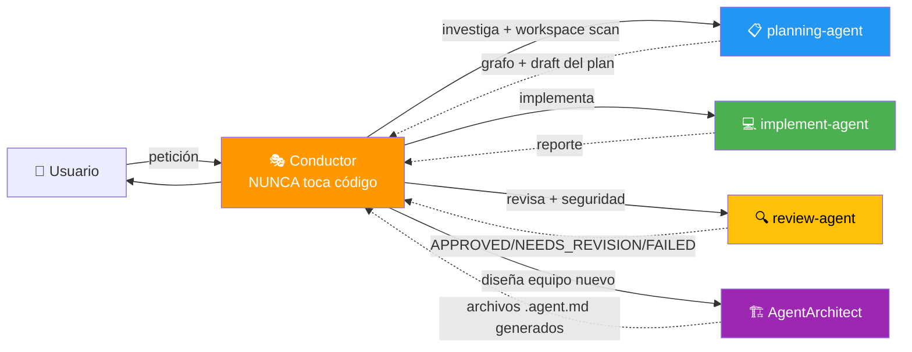

# Orquestacion Agentes Claude

> **Patrón Conductor + Subagentes para Claude Code** — Orquestación local de tareas complejas con Inteligencia Artificial integrada.

[](https://opensource.org/licenses/MIT)
[](https://claude.ai/code)
[](#arquitectura)
[](https://github.com/sponsors/elisaul77)
[](https://paypal.me/eflorezp)
[](https://buymeacoffee.com/elisaul77)

Sistema de orquestación multi-agente para **Claude Code**, implementando el patrón **Conductor + Subagentes**. El Conductor planifica y coordina; los subagentes ejecutan. Nunca al revés.

---

## ✨ Características principales

- 🎭 **Patrón Conductor**: Un agente central que planifica, coordina y nunca toca código
- 🤖 **Graphify integrado**: `planning-agent` construye un grafo de conocimiento del proyecto antes de planificar
- 🔍 **Review automático**: `review-agent` valida cada fase (APPROVED / NEEDS\_REVISION / FAILED) con criterios de seguridad OWASP
- 🏗️ **AgentArchitect**: Diseña y genera nuevos equipos de agentes en tiempo real
- ⏸️ **Pausas estratégicas**: El Conductor presenta el plan al usuario antes de ejecutar cada fase
- 📋 **Trazabilidad completa**: Planes escritos en `plans/*.md` y estado visible en TodoWrite

---

## 🏗️ Arquitectura



**Principio:** El Conductor COORDINA. Los subagentes EJECUTAN. La firma `🤖 [<agent>] ...` confirma qué subagente respondió.

---

## 🚀 Instalación rápida

### Requisitos previos
- [Claude Code](https://claude.ai/code) instalado y configurado
- Carpeta `~/.claude/` disponible

### Opción A — Clonar e instalar manualmente

```bash
git clone https://github.com/elisaul77/Orquestacion_Agentes_claude.git
cd Orquestacion_Agentes_claude

# Copiar skill
cp -r skills/subagent-pool ~/.claude/skills/

# Copiar agentes
cp agents/*.agent.md ~/.claude/agents/
```

### Opción B — Instalar directamente con curl

```bash
# Skill principal
mkdir -p ~/.claude/skills/subagent-pool/assets
curl -sSL https://raw.githubusercontent.com/elisaul77/Orquestacion_Agentes_claude/master/skills/subagent-pool/SKILL.md \
  -o ~/.claude/skills/subagent-pool/SKILL.md

# Agentes
for agent in planning-agent implement-agent review-agent AgentArchitect; do
  curl -sSL "https://raw.githubusercontent.com/elisaul77/Orquestacion_Agentes_claude/master/agents/${agent}.agent.md" \
    -o ~/.claude/agents/${agent}.agent.md
done
```

---

## 🎯 Uso

Activa el Conductor con cualquiera de estas frases en Claude Code:

| Frase | Resultado |
|-------|-----------|
| `usa el conductor para...` | Activa `subagent-pool` |
| `delegar a subagentes` | Activa `subagent-pool` |
| `orquesta la separación de...` | Activa `subagent-pool` |
| `tarea compleja: ...` | Activa `subagent-pool` |
| `diseña un equipo de agentes para...` | `subagent-pool` → `AgentArchitect` |

---

## 🔄 Flujo de trabajo v6.0

```
1. 🎭 Conductor se identifica y hace mini-entrevista (Q1, Q2, Q3)
2. 📋 Delega a planning-agent → workspace scan + graphify + draft del plan
3. ⏸️  PAUSA — presenta plan al usuario para aprobación
4. 📝 Escribe plan aprobado en plans/{tarea}-plan.md
5. Por cada fase:
   ├── 💻 implement-agent ejecuta
   ├── 🔍 review-agent valida → APPROVED / NEEDS_REVISION / FAILED
   ├── 🔁 Si NEEDS_REVISION → re-delega a implement-agent
   ├── ✅ Conductor actualiza TodoWrite
   └── ⏸️  PAUSA — resumen + sugerencia de commit msg
6. 📄 Conductor escribe plans/{tarea}-complete.md
```

---

## 📁 Estructura del repositorio

```
Orquestacion_Agentes_claude/
├── AGENTS.md                          # Visión general, reglas y diagrama del sistema
├── skills/
│   └── subagent-pool/
│       ├── SKILL.md                   # Skill principal — rol del Conductor
│       └── assets/
│           ├── prompts.md             # Templates de prompts para cada subagente
│           ├── agent-definitions.md   # Definiciones y troubleshooting
│           └── interview-protocol.md  # Protocolo de mini-entrevista completo
├── agents/
│   ├── planning-agent.agent.md        # Investiga y redacta el plan (con graphify)
│   ├── implement-agent.agent.md       # Implementa código y tests por fase
│   ├── review-agent.agent.md          # Revisa y valida cada fase
│   └── AgentArchitect.agent.md        # Diseña y genera nuevos equipos de agentes
├── LICENSE
├── FUNDING.md
└── README.md
```

---

## 🤝 Contribuir

¡Las contribuciones son bienvenidas! Para contribuir:

1. Haz un fork del repositorio
2. Crea una rama para tu feature (`git checkout -b feat/mi-mejora`)
3. Realiza tus cambios siguiendo las convenciones del proyecto
4. Crea un Pull Request describiendo los cambios

### Ideas para contribuir

- 🤖 Nuevos agentes especializados (frontend, DevOps, ML, etc.)
- 📚 Mejoras a la documentación y ejemplos de uso
- 🧪 Casos de prueba y escenarios de orquestación
- 🌐 Traducciones (English, Português)

---

## 💖 Apoya el Proyecto

Si este sistema de orquestación te resulta útil, considera apoyar su desarrollo:

- ⭐ **Dale una estrella** al repositorio
- 💰 **[Haz una donación](FUNDING.md)** para apoyar el desarrollo continuo
- 🐛 **Reporta bugs** y sugiere mejoras
- 📝 **Contribuye** con nuevos agentes o documentación
- 📢 **Comparte** el proyecto con otros usuarios de Claude Code

[](https://github.com/sponsors/elisaul77)
[](https://paypal.me/eflorezp)
[](https://buymeacoffee.com/elisaul77)

Ver todas las opciones de donación en **[FUNDING.md](FUNDING.md)**

---

## 📋 Roadmap

- [ ] Skill v7.0 con soporte multi-proyecto
- [ ] Agente especializado en testing (TDD-agent)
- [ ] Agente de documentación automática (docs-agent)
- [ ] Integración con herramientas MCP externas
- [ ] Dashboard de estado de orquestación

---

## 📄 Licencia

Este proyecto está licenciado bajo la **Licencia MIT** — ver [LICENSE](LICENSE) para más detalles.

Copyright (c) 2026 Elisaul Florez ([@elisaul77](https://github.com/elisaul77))

---

## 🐛 Reportar problemas

Usa el [sistema de issues](https://github.com/elisaul77/Orquestacion_Agentes_claude/issues) de GitHub para reportar bugs o sugerir mejoras.

---

**¡Gracias por usar el sistema de orquestación de agentes Claude!** 🎭🤖
