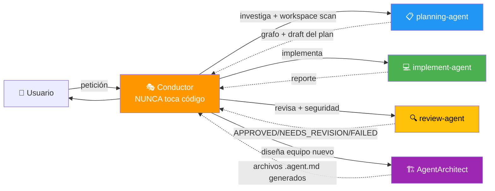

# Orquestacion Agentes Claude

> **Patrón Conductor + Subagentes para Claude Code** — Orquestación local de tareas complejas con Inteligencia Artificial integrada.

[](https://opensource.org/licenses/MIT)
[](https://claude.ai/code)
[](#arquitectura)
[](https://github.com/safishamsi/graphify)
[](https://github.com/sponsors/elisaul77)
[](https://paypal.me/eflorezp)
[](https://buymeacoffee.com/elisaul77)

Sistema de orquestación multi-agente para **Claude Code**, implementando el patrón **Conductor + Subagentes**. El Conductor planifica y coordina; los subagentes ejecutan. Nunca al revés.

---

## ✨ Características principales

- 🎭 **Patrón Conductor**: Un agente central que planifica, coordina y nunca toca código
- 🤖 **Graphify integrado**: `planning-agent` construye un grafo de conocimiento del proyecto antes de planificar
- 🔍 **Review automático**: `review-agent` valida cada fase (APPROVED / NEEDS\_REVISION / FAILED) con criterios de seguridad OWASP
- 🏗️ **AgentArchitect**: Diseña y genera nuevos equipos de agentes en tiempo real
- ⏸️ **Pausas estratégicas**: El Conductor presenta el plan al usuario antes de ejecutar cada fase
- 📋 **Trazabilidad completa**: Planes escritos en `plans/*.md` y estado visible en TodoWrite

### Novedades v9.0 — basadas en investigación 2025-2026

- 📏 **Esfuerzo a escala**: niveles S/M/L. Lo pequeño no se orquesta (multiagente cuesta ~15× tokens).
- 💡 **Ronda divergente (creatividad)**: 2-3 forks independientes con lentes distintas y opciones con probabilidad (*Verbalized Sampling*), sin verse entre sí para evitar el colapso de diversidad.
- 🛡️ **Gobierno de actuaciones**: niveles Auto / Avisar / Aprobar. Borrar, migrar, secretos, push, publicar o desplegar siempre pasan por el usuario. Máximo 2 vueltas de revisión antes de escalar.
- 🧪 **Integridad de tests**: el implementador nunca debilita tests; el revisor revisa su diff y corre una comprobación propia.
- 🗣️ **Comunicación**: resultado primero, malas noticias claras, confianza calibrada, preguntar solo lo que cambia el plan (cada pregunta con su valor por defecto).
- 🪙 **Ahorro de tokens**: la skill pasa de 667 a ~170 líneas; plantillas en `assets/` (divulgación progresiva); planes por archivo, no pegados.
- 🎛️ **Tú controlas los modelos**: el `model:` de cada `.agent.md` manda; el Conductor no lo sobrescribe (por defecto: implement = haiku, planning/review = sonnet).

Fuentes y razonamiento: [`skills/subagent-pool/assets/research.md`](skills/subagent-pool/assets/research.md) · cambios: [CHANGELOG.md](CHANGELOG.md)

---

## 🏗️ Arquitectura



**Principio:** El Conductor COORDINA. Los subagentes EJECUTAN. La firma `🤖 [<agent>] ...` confirma qué subagente respondió.

---

## 🚀 Instalación rápida

### Requisitos previos
- [Claude Code](https://claude.ai/code) instalado y configurado
- Carpeta `~/.claude/` disponible

### Opción A — Clonar e instalar manualmente

```bash
git clone https://github.com/elisaul77/Orquestacion_Agentes_claude.git
cd Orquestacion_Agentes_claude

# Copiar skills
cp -r skills/subagent-pool ~/.claude/skills/
cp -r skills/arquitec-dev-ia ~/.claude/skills/
cp -r skills/graphify ~/.claude/skills/

# Copiar agentes
cp agents/*.agent.md ~/.claude/agents/
```

### Opción B — Instalar directamente con curl

```bash
# Skills
BASE=https://raw.githubusercontent.com/elisaul77/Orquestacion_Agentes_claude/master
for skill in subagent-pool arquitec-dev-ia graphify; do
  mkdir -p ~/.claude/skills/${skill}
  curl -sSL "$BASE/skills/${skill}/SKILL.md" -o ~/.claude/skills/${skill}/SKILL.md
done
mkdir -p ~/.claude/skills/subagent-pool/assets
for f in prompts research interview-protocol agent-definitions; do
  curl -sSL "$BASE/skills/subagent-pool/assets/${f}.md" -o ~/.claude/skills/subagent-pool/assets/${f}.md
done

# Agentes
for agent in planning-agent implement-agent review-agent AgentArchitect; do
  curl -sSL "https://raw.githubusercontent.com/elisaul77/Orquestacion_Agentes_claude/master/agents/${agent}.agent.md" \
    -o ~/.claude/agents/${agent}.agent.md
done
```

> **Nota:** El skill `graphify` requiere instalar la herramienta por separado.
> Ver la sección [Graphify — Grafo de Conocimiento](#-graphify--grafo-de-conocimiento) más abajo.

---

## 🎯 Uso

Activa el Conductor con cualquiera de estas frases en Claude Code:

| Frase | Resultado |
|-------|-----------|
| `usa el conductor para...` | Activa `subagent-pool` |
| `delegar a subagentes` | Activa `subagent-pool` |
| `orquesta la separación de...` | Activa `subagent-pool` |
| `tarea compleja: ...` | Activa `subagent-pool` |
| `diseña un equipo de agentes para...` | `subagent-pool` → `AgentArchitect` |

---

## 🔄 Flujo de trabajo v9.0

```
0. 🔐 Lee .claude/project-context.md (o sugiere arquitec-dev-ia) · ofrece reanudar si hay state.md
1. 📏 Decide el nivel: S (directo) · M · L
2. ❓ Pregunta solo lo que cambia el plan; el resto lo asume y lo declara
3. 💡 (L con decisión de diseño) Ronda divergente → el usuario elige el enfoque
4. 📋 planning-agent → plan en plans/{tarea}-draft.md
5. ⏸️  PAUSA — aprobación del plan
6. Por cada fase:
   ├── 💻 implement-agent ejecuta (Aprobar-tier → BLOCKED y pregunta)
   ├── 🔍 review-agent: contrato primero + comprobación independiente
   ├── 🔁 NEEDS_REVISION → máx. 2 vueltas, luego consulta
   ├── 💾 checkpoint plans/{tarea}-state.md
   └── ⏸️  pausa solo si toca god node, acción a aprobar, FAILED o lo pediste
7. 📄 Informe final: qué cambió · cómo se verificó · qué falta · commit
```

---

## 🔬 Estado del arte → qué se implementó (v9.0)

Investigación de octubre de 2026 sobre creatividad, gobierno de agentes y nuevas capacidades de los modelos. Cada fila es un hallazgo y la regla que generó. Detalle y enlaces en [`research.md`](skills/subagent-pool/assets/research.md).

| Hallazgo | Fuente | Qué hace ahora la skill |
|---|---|---|
| Los modelos alineados caen en la respuesta "típica" (*mode collapse*); pedir varias respuestas **con su probabilidad** aumenta 1,6–2,1× la diversidad sin perder precisión | Verbalized Sampling (arXiv 2510.01171) | En la ronda divergente cada fork devuelve 2-3 opciones con probabilidad, incluida una poco probable |
| Agentes que ven las ideas de los demás, o un líder que opina primero, convergen antes de tiempo | Diversity Collapse in MAS (arXiv 2604.18005) | Los forks trabajan aislados y el Conductor no revela su preferencia hasta converger |
| El debate entre agentes reduce la diversidad (deriva de identidad, presión de la mayoría) | Creative-MAD (arXiv 2609.00683) | Cada fork recibe una lente fija y distinta: simple / robusta / no convencional |
| La mayoría de los fallos multiagente vienen del diseño y de **no saber cuándo verificar o parar** | MAST, NeurIPS 2025 (arXiv 2503.13657) | Contratos de retorno, el veredicto del revisor decide y máximo 2 vueltas de revisión antes de escalar |
| Los puntos de control humano solo sirven si cambian el control; si no, son un sello de goma | Marco IMDA / Singapore Consensus 2026 | Niveles Auto / Avisar / Aprobar; las pausas por fase solo aparecen donde hay riesgo real |
| Los agentes de código a veces "hacen trampa" con los tests, y más cuanto más grande es el código | EvilGenie (2511.21654), SpecBench (2605.21384) | Prohibido debilitar tests; el revisor revisa su diff y corre una comprobación propia (`[TEST-INTEGRITY]`) |
| Un juez LLM prefiere los textos parecidos a los suyos | Self-Preference Bias (arXiv 2410.21819) | Se recomienda revisor y implementador en modelos distintos (por defecto sonnet revisa a haiku) |
| Preguntar solo cuando la incertidumbre importa resuelve más tareas con menos preguntas | Ask or Assume? (2603.26233), ACL 2026 Findings | "Preguntar o asumir": máximo 3 preguntas con valor por defecto; el resto se declara como supuesto |
| Multiagente rinde mucho en tareas amplias pero cuesta ~15× tokens; el gasto explica ~80% del rendimiento | Anthropic, sistema de investigación multiagente | Niveles S/M/L: lo pequeño no se orquesta |
| Los archivos de instrucciones largos empeoran a los agentes y suben el coste más de un 20% | Evaluating AGENTS.md (arXiv 2602.11988) | La skill pasa de 667 a ~170 líneas y quita lo que el modelo ya sabe |
| "Claude ya es muy listo": solo añade lo que no sabe; menos de 500 líneas y detalles en archivos aparte | Guía oficial de skills de Anthropic | Plantillas en `assets/` (divulgación progresiva); el detalle del prompt se ajusta al modelo |
| Menos contexto acumulado = más éxito y menos tokens | Less Context, Better Agents (2026) | Los planes viajan por archivo (`PLAN_FILE`), no pegados; estado en una línea |
| Los horizontes de tarea se duplican cada 4-7 meses, pero la fiabilidad en tareas largas sigue cojeando | METR 2026 | Se delegan resultados y criterios (no pasos obvios), con checkpoint externo y verificación independiente |

**Habilidades blandas añadidas al Conductor:** primero el resultado, las malas noticias claras, separar lo *verificado* de lo *creído*, discrepar una vez con argumentos y luego respetar la decisión, recomendar en vez de listar opciones, y un informe final honesto.

---

## 📁 Estructura del repositorio

```
Orquestacion_Agentes_claude/
├── AGENTS.md                          # Visión general, reglas y diagrama del sistema
├── skills/
│   ├── subagent-pool/
│   │   ├── SKILL.md                   # Skill principal — rol del Conductor
│   │   └── assets/
│   │       ├── prompts.md             # Plantillas de Task + contratos de retorno
│   │       ├── research.md            # Evidencia y fuentes detrás de cada regla v9
│   │       ├── agent-definitions.md   # Definiciones y troubleshooting
│   │       └── interview-protocol.md  # Protocolo de mini-entrevista completo
│   ├── arquitec-dev-ia/
│   │   ├── SKILL.md                   # Skill de documentación de contexto IA
│   │   ├── assets/                    # Templates AGENTS.md, CLAUDE.md, skills
│   │   └── references/                # Documentación de referencia
│   └── graphify/
│       └── SKILL.md                   # Skill de grafo de conocimiento (ver sección abajo)
├── agents/
│   ├── planning-agent.agent.md        # Investiga y redacta el plan (con graphify)
│   ├── implement-agent.agent.md       # Implementa código y tests por fase
│   ├── review-agent.agent.md          # Revisa y valida cada fase
│   └── AgentArchitect.agent.md        # Diseña y genera nuevos equipos de agentes
├── CHANGELOG.md
├── LICENSE
├── FUNDING.md
└── README.md
```

---

## 🧠 Graphify — Grafo de Conocimiento

Este stack incluye el skill **[graphify](https://github.com/safishamsi/graphify)**, una herramienta de terceros que convierte cualquier repositorio de código, documentos, PDFs, imágenes y videos en un **grafo de conocimiento consultable**.

El `planning-agent` lo usa automáticamente para investigar el codebase antes de planificar — reemplaza el Glob/Grep manual en proyectos medianos y grandes, revelando dependencias y conexiones ocultas que no serían evidentes leyendo archivos uno por uno.

> Proyecto original: **[github.com/safishamsi/graphify](https://github.com/safishamsi/graphify)**

### Instalación de Graphify

Graphify se instala por separado como herramienta global. Requiere Python 3.10+ y `uv` (recomendado).

```bash
# Instalar con uv (recomendado)
uv tool install graphifyy

# Registrar el skill en Claude Code
graphify install
```

> El nombre del paquete en PyPI es `graphifyy` (doble y), pero el comando CLI es `graphify`.

**Alternativa con pipx:**
```bash
pipx install graphifyy
graphify install
```

**Verificar instalación:**
```bash
graphify --version
```

### Uso básico

```bash
# En Claude Code — analizar el proyecto actual
/graphify .

# Analizar un path específico
/graphify ./src

# Analizar un repositorio remoto directamente
/graphify https://github.com/owner/repo

# Consulta semántica sobre el grafo generado
/graphify query "¿dónde se maneja la autenticación?"

# Camino más corto entre dos conceptos
/graphify path "AuthModule" "Database"

# Actualización incremental (solo archivos nuevos/modificados)
/graphify . --update

# Exportar como servidor MCP para acceso programático
/graphify . --mcp
```

### Outputs generados

Tras ejecutar `/graphify .`, se crea la carpeta `graphify-out/` con:

| Archivo | Descripción |
|---------|-------------|
| `graph.html` | Grafo interactivo — abrir en navegador |
| `GRAPH_REPORT.md` | Reporte con nodos clave, conexiones sorpresa y preguntas sugeridas |
| `graph.json` | Datos raw del grafo para consultas programáticas |

### Integración con el planning-agent

El `planning-agent` de este stack detecta automáticamente si existe `graphify-out/` en el proyecto. Si está disponible, lo usa para:

1. Identificar los **god nodes** (componentes más conectados)
2. Descubrir dependencias entre módulos sin leer todos los archivos
3. Generar un plan de implementación informado por la estructura real del código

Si `graphify-out/` no existe, el agente hace workspace scan manual con Glob/Grep.

---

## 🤝 Contribuir

¡Las contribuciones son bienvenidas! Para contribuir:

1. Haz un fork del repositorio
2. Crea una rama para tu feature (`git checkout -b feat/mi-mejora`)
3. Realiza tus cambios siguiendo las convenciones del proyecto
4. Crea un Pull Request describiendo los cambios

### Ideas para contribuir

- 🤖 Nuevos agentes especializados (frontend, DevOps, ML, etc.)
- 📚 Mejoras a la documentación y ejemplos de uso
- 🧪 Casos de prueba y escenarios de orquestación
- 🌐 Traducciones (English, Português)

---

## 💖 Apoya el Proyecto

Si este sistema de orquestación te resulta útil, considera apoyar su desarrollo:

- ⭐ **Dale una estrella** al repositorio
- 💰 **[Haz una donación](FUNDING.md)** para apoyar el desarrollo continuo
- 🐛 **Reporta bugs** y sugiere mejoras
- 📝 **Contribuye** con nuevos agentes o documentación
- 📢 **Comparte** el proyecto con otros usuarios de Claude Code

[](https://github.com/sponsors/elisaul77)
[](https://paypal.me/eflorezp)
[](https://buymeacoffee.com/elisaul77)

Ver todas las opciones de donación en **[FUNDING.md](FUNDING.md)**

---

## 📋 Roadmap

- [x] Skill v9.0 basada en investigación (creatividad, gobierno, ahorro de tokens)
- [ ] Evals reproducibles de la skill con Haiku / Sonnet / Opus
- [ ] Skill v7.0 con soporte multi-proyecto
- [ ] Agente especializado en testing (TDD-agent)
- [ ] Agente de documentación automática (docs-agent)
- [ ] Integración con herramientas MCP externas
- [ ] Dashboard de estado de orquestación

---

## 📄 Licencia

Este proyecto está licenciado bajo la **Licencia MIT** — ver [LICENSE](LICENSE) para más detalles.

Copyright (c) 2026 Elisaul Florez ([@elisaul77](https://github.com/elisaul77))

---

## 🐛 Reportar problemas

Usa el [sistema de issues](https://github.com/elisaul77/Orquestacion_Agentes_claude/issues) de GitHub para reportar bugs o sugerir mejoras.

---

**¡Gracias por usar el sistema de orquestación de agentes Claude!** 🎭🤖
