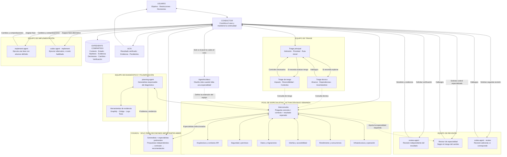
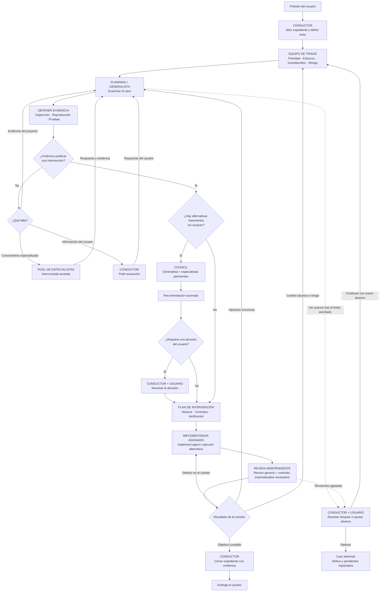

# Proposal — case-care flow for subagent-pool (status: PROPOSED, 2026-10-17)

Evolve subagent-pool into a case-handling flow inspired by admission → triage → diagnosis → intervention → discharge,
**inside the existing instructions, contracts and agents** (no medical app, no new framework, no agent per stage).

## Brief (author's request, condensed)

1. **One case, one owner.** Every request has a case file; the Conductor keeps continuity and picks the next action.
2. **Admission:** objective, available context, constraints, success criterion. Ask only what is missing.
3. **Triage on four separate axes:** urgency (priority) · effort (direct vs phases) · uncertainty (investigate,
   consult, compare alternatives) · risk (controls, specialist verification). Urgency ≠ complexity. Touching data,
   APIs or security does **not** trigger the council by itself. Re-triage when diagnosis changes scope or risk.
4. **Diagnosis:** facts vs hypotheses vs evidence. Evidence tools chosen per case. "Enough evidence" = we can justify
   an understanding and propose an intervention (not that the fix is validated). Missing info comes from the project,
   a specialist or the user. Bounded loops with escalation.
5. **Consult vs council:** a consult answers one bounded question; the council compares alternatives when an important
   decision is still open. Unambiguous single/duo/council criteria, consistent with S/M/L.
6. **Intervention and review:** plan = scope, verification, recovery when relevant. Review outcome routes back:
   implementation defect → implementer · wrong hypothesis → diagnosis · goal verified → close.
   "Change verified" ≠ "deployed"; closing never authorizes a publish or deploy.
7. **Case file**, proportional: objective, classification + reason, owner, status, hypotheses, evidence, decisions,
   changes, verification, next action. Reuse `plans/` and the state files; small tasks stay short.

Validation cases: trivial change · bug with unknown cause · small sensitive change (specialist review, no automatic
council) · architectural decision with alternatives (council justified) · review failure by implementation · failure
by wrong hypothesis · information only the user has · investigation with no progress (bounded exit).
Structural tests must not be presented as evidence that a model routes correctly.

## Diagram 1 — roles

## Diagram 2 — case flow

