# Arquitecto de Documentación de Contexto IA

> Skill para crear y mantener **documentación de contexto** orientada a agentes IA:
> `AGENTS.md`, `CLAUDE.md`, `copilot-instructions.md`, skills y diagramas Mermaid.
>
> ⚠️ **Límite de responsabilidad**: Esta skill NO crea agentes ejecutables (`.agent.md`).
> Para diseñar y generar equipos de agentes Claude Code → usar **AgentArchitect**.

---

## Cuándo Usar

| ✅ Esta skill | ❌ Usar AgentArchitect en su lugar |
|---|---|
| Crear/actualizar `AGENTS.md` (root o componente) | Crear agentes `.agent.md` en `.claude/agents/` |
| Crear/actualizar `CLAUDE.md` | Diseñar equipos Conductor + especialistas |
| Crear/actualizar `copilot-instructions.md` | Definir herramientas y modelos de agentes |
| Crear nuevas skills (SKILL.md) | Establecer jerarquía de orquestación |
| Documentar arquitectura con diagramas Mermaid | |
| Estructurar mono-repo para trabajo con IA | |
| Definir convenciones y cultura del proyecto | |
| Reducir contexto innecesario para evitar alucinaciones | |

---


## Filosofía Central

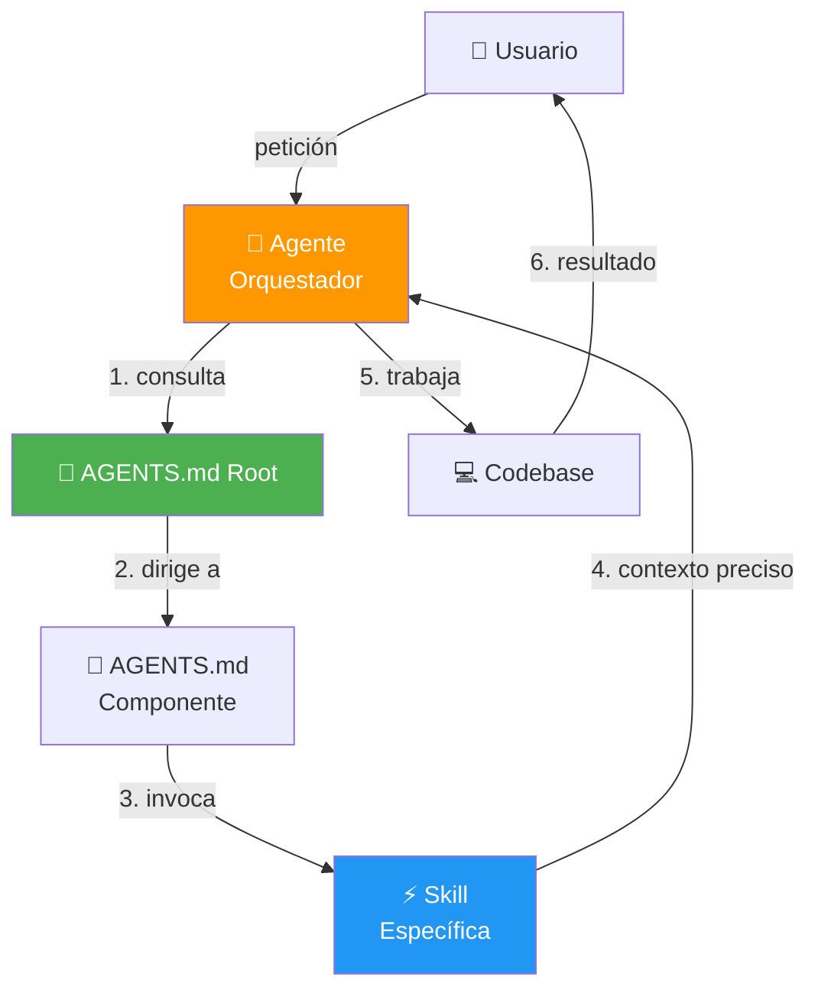

**Principio clave**: Menos contexto = menos alucinación. El agente solo debe recibir
lo que necesita, cuando lo necesita.

---

## Arquitectura de Documentación IA

### Jerarquía de Archivos

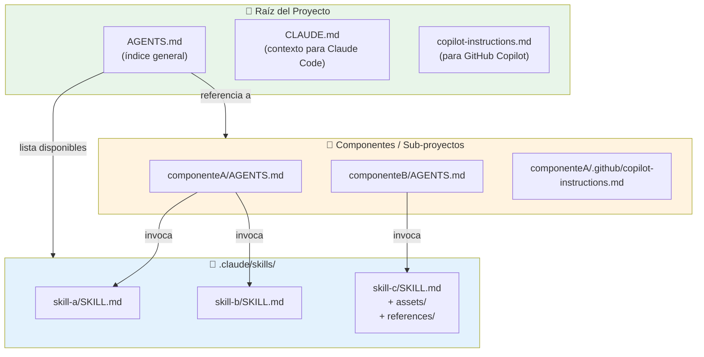

### Regla de Tamaño

| Archivo | Líneas Recomendadas | Máximo |
|---------|-------------------|--------|
| `AGENTS.md` root | ~150 | 250 |
| `AGENTS.md` componente | ~150 | 300 |
| `copilot-instructions.md` | ~100 | 250 |
| `SKILL.md` | ~100 | 300 |

> **Si supera el máximo → dividir en archivos por componente o extraer a skills.**

---

## Patrón: AGENTS.md Root

El AGENTS.md root es el **punto de entrada** para cualquier agente. Debe contener:

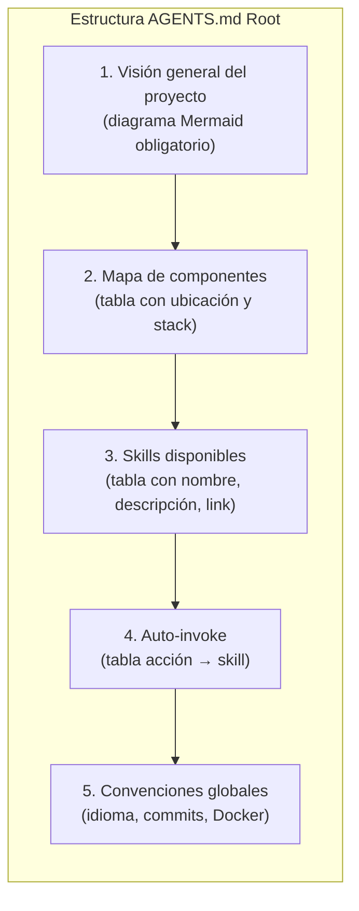

### Template Mínimo

```markdown
# Proyecto — AGENTS.md

## Visión General
<!-- Diagrama Mermaid de arquitectura -->

## Componentes
| Componente | Ubicación | Stack | AGENTS.md |
|---|---|---|---|

## Skills Disponibles
| Skill | Descripción | URL |
|---|---|---|

## Auto-invoke Skills
| Acción | Skill |
|---|---|

## Convenciones
- Idioma: español
- Commits: conventional-commits
- Todo en Docker
```

---

## Patrón: Skills

### Estructura de Carpeta

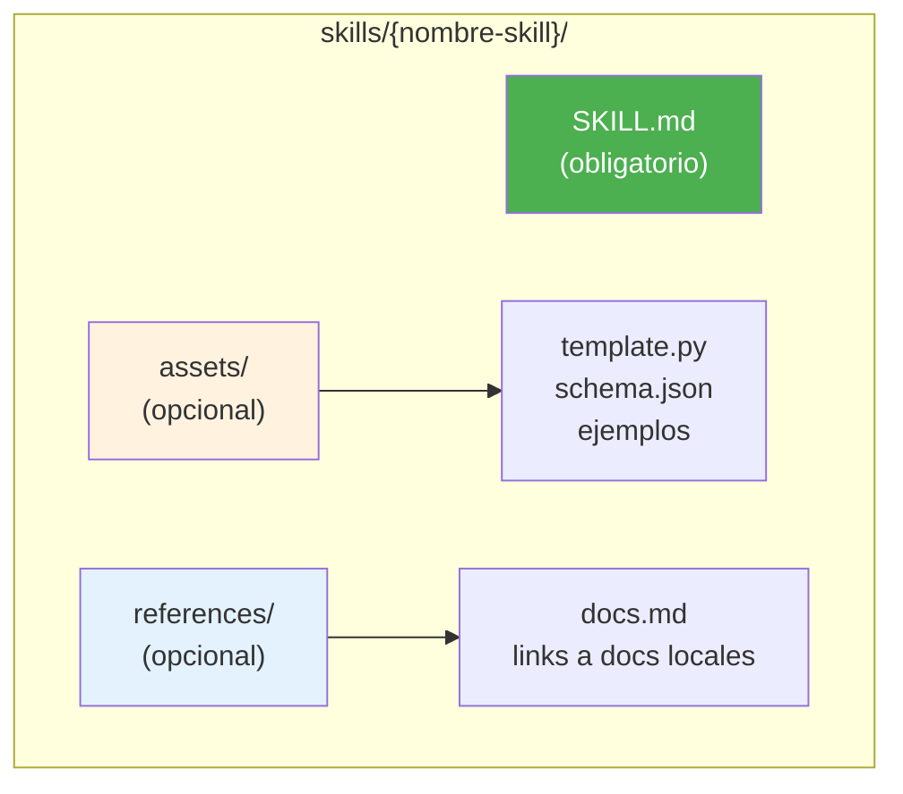

### Frontmatter Obligatorio

```yaml
---
name: nombre-skill            # lowercase, guiones
description: >
  Qué hace esta skill.
  Trigger: Cuándo invocarla.
license: MIT
metadata:
  author: eliflowi
  version: "1.0"
  scope: [root|ui|api|infra]  # dónde aplica
  auto_invoke: "Acción que trigerea esta skill"
allowed-tools: Read, Edit, Write, Glob, Grep, Bash
---
```

### Decisión: assets/ vs references/

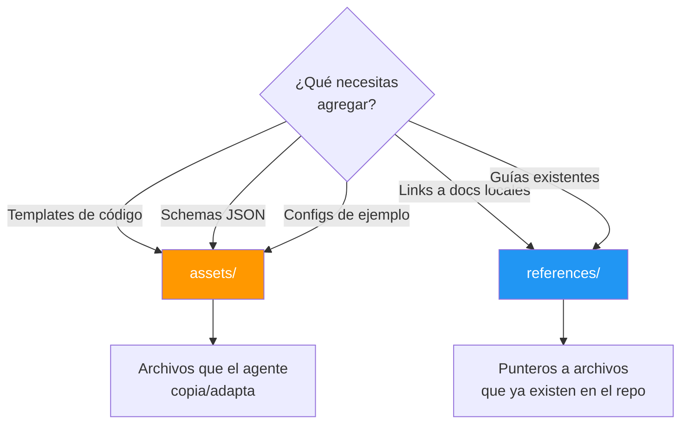

---

## Patrón: Diagramas Mermaid

**Regla crítica**: Siempre preferir diagramas Mermaid sobre texto narrativo para:

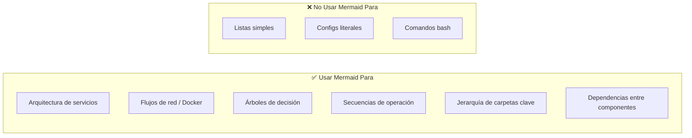

### Tipos de Diagrama por Situación

| Situación | Tipo Mermaid | Ejemplo |
|-----------|-------------|---------|
| Arquitectura de servicios | `flowchart TB` | Contenedores, puertos, redes |
| Flujo de request | `sequenceDiagram` | HTTP request → response |
| Decisiones | `flowchart TD` con nodos `{}` | Árbol de troubleshooting |
| Topología de red | `flowchart LR` con subgraphs | Docker networks |
| Timeline de deploy | `sequenceDiagram` | Pasos de despliegue |
| Relaciones de datos | `erDiagram` | Modelos/tablas DB |
| Estados | `stateDiagram-v2` | Ciclo de vida de un recurso |

### Ejemplo: Arquitectura de Servicios

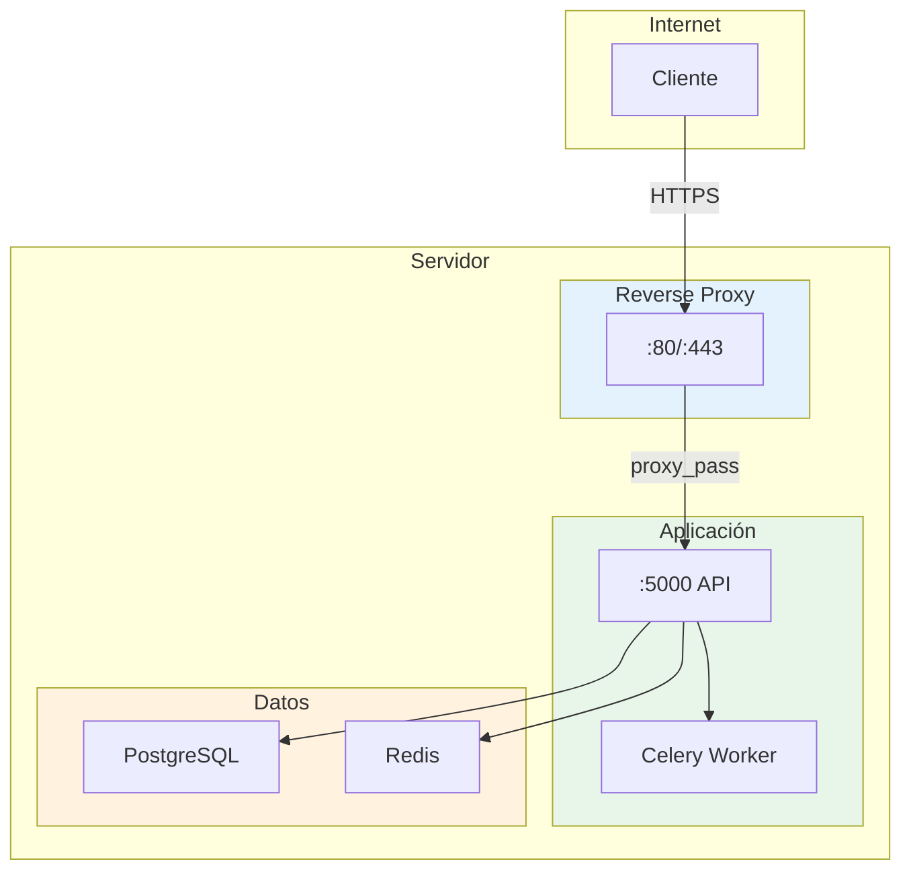

### Ejemplo: Flujo de Decisión

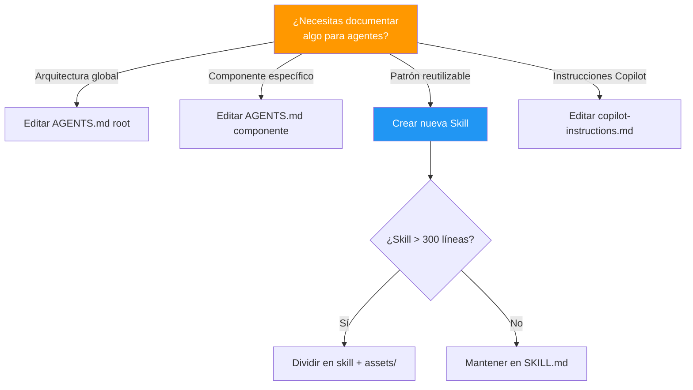

---

## Relación con AgentArchitect y subagent-pool

Esta skill produce **documentación de contexto** que los agentes ejecutables *leen*.
El ciclo completo es:

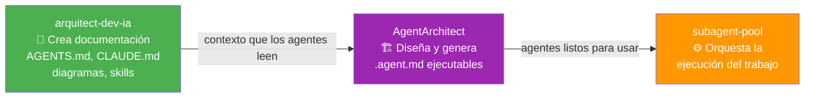

- **Esta skill** → primero, para que el proyecto sea legible para cualquier agente IA
- **AgentArchitect** → cuando necesites crear un equipo de agentes ejecutables
- **subagent-pool** → cuando el equipo ya existe y hay trabajo que orquestar

---

## Flujo Completo: Crear Documentación IA para un Proyecto

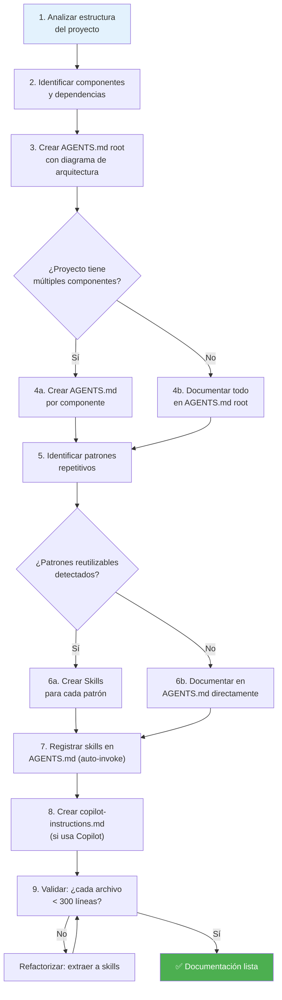

---

## Convenciones para eliflowi.com

Estas son las convenciones específicas de este servidor multi-proyecto:

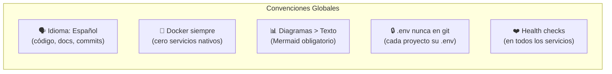

| Convención | Regla |
|-----------|-------|
| Idioma | Español en todo: código, comments, docs, commits |
| Docker | Todo se ejecuta en contenedores, sin excepción |
| Diagramas | Mermaid obligatorio para arquitectura, flujos y decisiones |
| `.env` | Nunca en git — cada proyecto espera su propio `.env` |
| Health checks | Todos los servicios principales deben tenerlo |
| IPs fijas | En `infrastructure/`, cada servicio tiene IP estática `172.22.0.x` |
| Volúmenes externos | En `apigateway/`, crear con `docker volume create` previo |

---

## Checklist: Documentación IA Completa

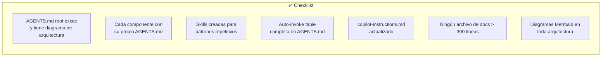

- [ ] `AGENTS.md` root con diagrama de arquitectura Mermaid
- [ ] `AGENTS.md` por componente (si aplica)
- [ ] Skills para patrones repetitivos (commits, PRs, testing, etc.)
- [ ] Tabla auto-invoke en cada `AGENTS.md`
- [ ] `copilot-instructions.md` para Copilot
- [ ] Ningún archivo de documentación supera 300 líneas
- [ ] Toda arquitectura documentada con diagramas Mermaid
- [ ] Frontmatter completo en cada skill (`name`, `description`, `allowed-tools`, `metadata.scope`)
- [ ] `assets/` con templates y ejemplos cuando la skill es compleja
- [ ] `references/` apuntando a docs locales (no URLs web)

---

## Comandos Útiles

```bash
# Contar líneas de un archivo de agente
wc -l AGENTS.md

# Buscar todas las skills del proyecto
find . -name "SKILL.md" -type f

# Buscar todos los AGENTS.md
find . -name "AGENTS.md" -type f

# Buscar copilot-instructions
find . -path "*/.github/copilot-instructions.md" -type f

# Verificar que Mermaid es válido (si hay herramienta instalada)
# npx @mermaid-js/mermaid-cli -i archivo.md -o output.svg

# Ver estructura de skills
tree .claude/skills/ 2>/dev/null || find .claude/skills -type f | head -20
```

---

## Anti-patrones

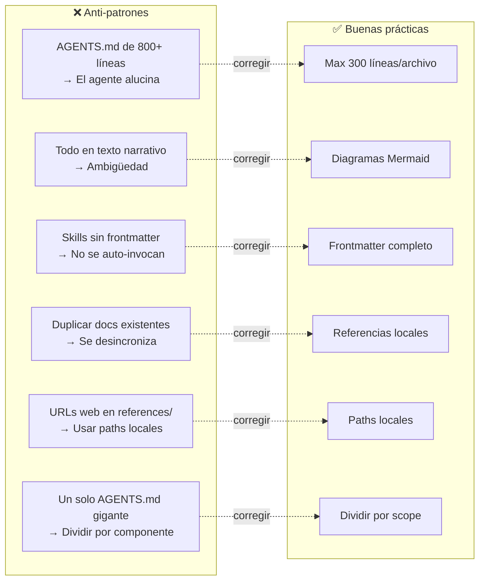

---

## Resources

- **Templates**: Ver [assets/](assets/) para templates de AGENTS.md y SKILL.md
- **Referencia**: Ver [references/](references/) para la guía de arquitectura del servidor eliflowi.com
```
