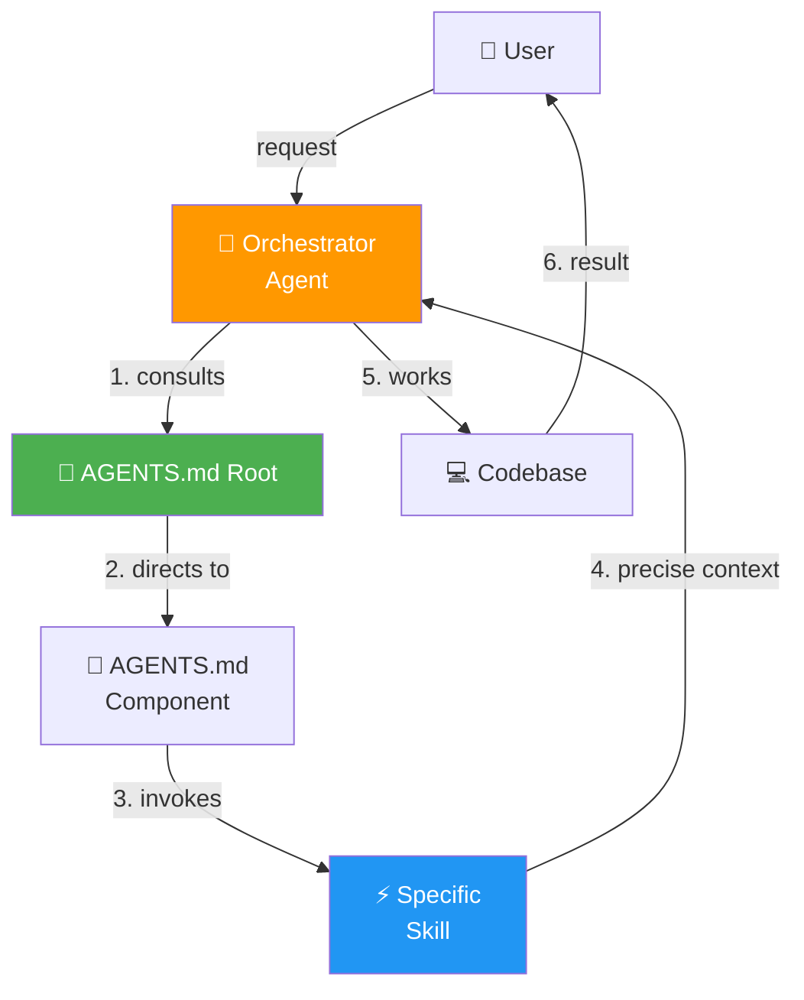
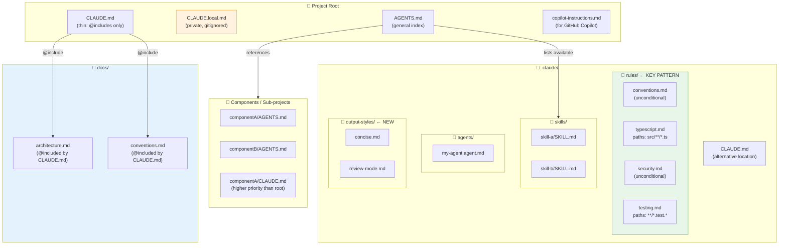
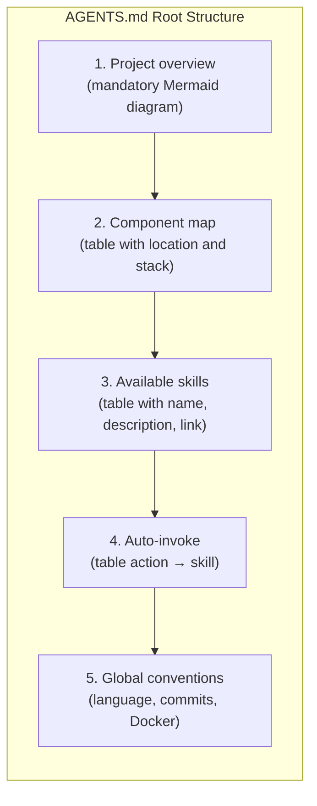
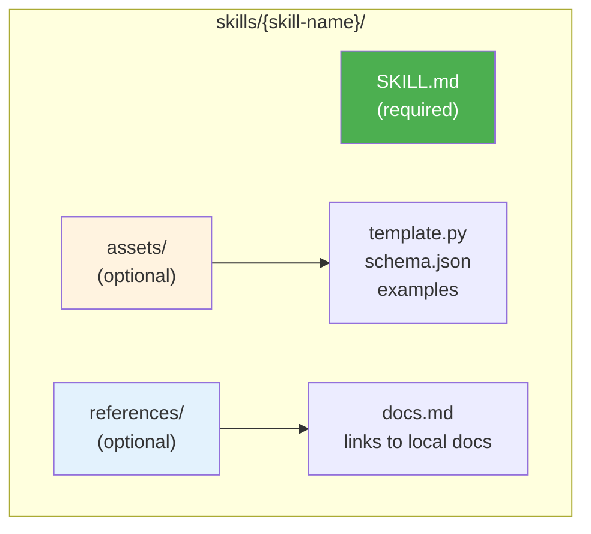
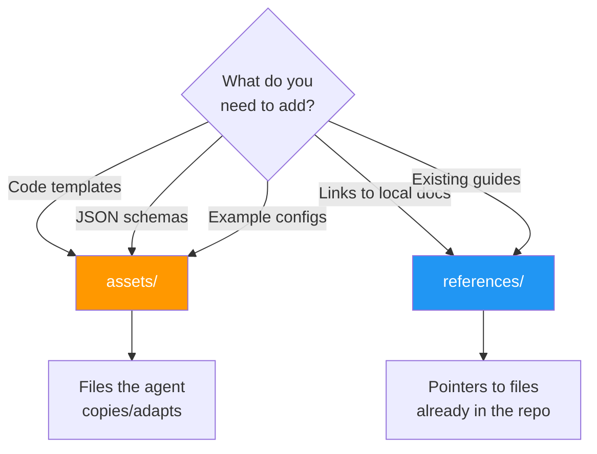
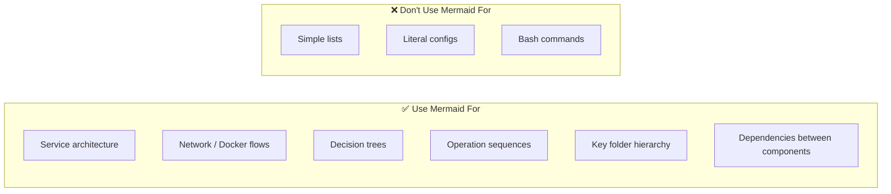
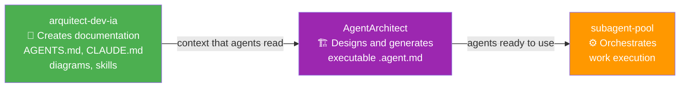
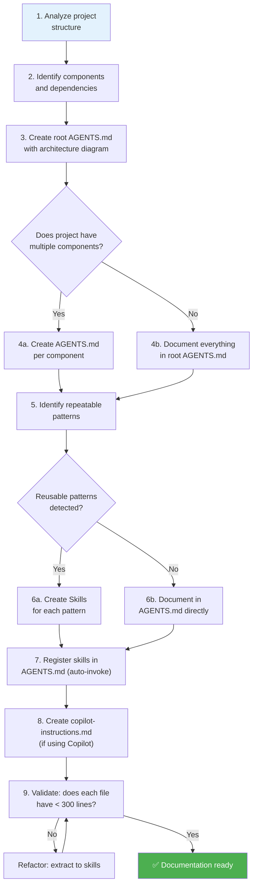

# AI Context Documentation Architect v4.0

> Skill for creating and maintaining **context documentation** oriented towards AI agents:
> `AGENTS.md`, `CLAUDE.md`, `.claude/rules/*.md`, `CLAUDE.local.md`, `copilot-instructions.md`, skills and Mermaid diagrams.
>
> ⚠️ **Scope limit**: This skill does NOT create executable agents (`.agent.md`).
> To design and generate Claude Code agent teams → use **AgentArchitect**.

---

## When to Use

| ✅ This skill | ❌ Use AgentArchitect instead |
|---|---|
| Create/update `AGENTS.md` (root or component) | Create `.agent.md` agents in `.claude/agents/` |
| Create/update `CLAUDE.md` | Design Conductor + specialists teams |
| Create/update `copilot-instructions.md` | Define agent tools and models |
| Create new skills (SKILL.md) | Establish orchestration hierarchy |
| Document architecture with Mermaid diagrams | |
| Structure mono-repo for AI work | |
| Define project conventions and culture | |
| Reduce unnecessary context to avoid hallucinations | |

---

## 🧠 How Claude Code Actually Loads Context (Source-Verified)

> Extracted directly from `src/utils/claudemd.ts`. Understanding this is the foundation of good context architecture.

### 4-Tier Memory Hierarchy

Files load in this order — **later = higher priority** (the model pays more attention to last-loaded):

```
1. Managed    /etc/claude-code/CLAUDE.md        ← org-wide, admin-controlled
2. User       ~/.claude/CLAUDE.md               ← personal, all projects
3. Project    CLAUDE.md / .claude/CLAUDE.md     ← checked into repo
              .claude/rules/*.md                ← modular rules (see below)
4. Local      CLAUDE.local.md                   ← private, gitignored
```

**Directory traversal**: Claude scans from **CWD upward to root**. A file at `project/frontend/CLAUDE.md` is loaded AFTER `project/CLAUDE.md` — so the closer to CWD, the higher the priority.

### Hard Limits (from source)
| Constraint | Value | Source |
|---|---|---|
| Max characters per memory file | **40,000** | `MAX_MEMORY_CHARACTER_COUNT = 40000` |
| Binary files in @include | Skipped silently | `Skip non-text files` |
| Circular @include refs | Prevented | cycle detection in loader |
| HTML comments | **Stripped before injection** | `stripHtmlComments()` |
| Memory cache | Reset on `/clear` or `/compact` | `memoize(getMemoryFiles)` |

---

## 📁 `.claude/rules/` — Modular Context Architecture

**This is the most powerful pattern** — all `.md` files in `.claude/rules/` are automatically loaded as project memory. Two types:

### Unconditional Rules (no frontmatter `paths:`)
Always loaded. Use for project-wide conventions, architecture, style guides.

```
.claude/rules/
  conventions.md       ← naming, language, commit format
  architecture.md      ← component map, dependencies
  security.md          ← OWASP checklist, forbidden patterns
  testing.md           ← test patterns, coverage requirements
  docker.md            ← docker conventions specific to this project
```

### Conditional Rules (frontmatter `paths:`)
Only injected when Claude is working on files that match the glob pattern.

```markdown
---
paths:
  - src/**/*.ts
  - "*.test.ts"
---

# TypeScript Rules
- Always use strict mode
- No `any` — use `unknown` with type guards
- Tests: use vitest, never jest
```

```markdown
---
paths:
  - backend/**/*.py
---

# Python Backend Rules
- Use FastAPI patterns
- Always validate with Pydantic models
- Never expose internal stack traces
```

**Why this matters**: Claude only receives the relevant rules for the files it's working on. Reduces noise, reduces hallucination.

---

## 🔗 `@include` — Composición Modular

CLAUDE.md files can include other files. Non-existent paths are silently ignored.

```markdown
# CLAUDE.md

## Architecture
@./docs/architecture.md

## API Conventions
@./docs/api-conventions.md

## Shared Rules (from parent project)
@../shared-rules/security.md
```

**Supported syntaxes:**
```
@path                 → relative (same as @./path)
@./relative/path      → relative to current file
@~/home/path          → from home directory
@/absolute/path       → absolute path
```

**Rules:**
- Only works in leaf text nodes — NOT inside code blocks
- Circular references are detected and stopped
- Binary files (images, PDFs) are skipped silently

**Pattern: thin CLAUDE.md + rich docs/**
```
project/
  CLAUDE.md            ← thin: @includes only, ~20 lines
  docs/
    architecture.md    ← full architecture, diagrams
    conventions.md     ← coding standards
    onboarding.md      ← how to work in this repo
  .claude/rules/
    typescript.md      ← conditional: paths: src/**/*.ts
    security.md        ← unconditional: always apply
```

---

## 🔒 `CLAUDE.local.md` — Private Context (gitignored)

Personal instructions that override project context WITHOUT being committed to the repo.

```markdown
# CLAUDE.local.md
<!-- This file is gitignored. Personal notes only. -->

## My Working Style
- I prefer TypeScript strict mode — always suggest it
- For this project: focus on the auth module (currently refactoring)
- Skip boilerplate suggestions, I know the stack

## Current Focus (2026-05)
Working on OAuth migration. Files in scope: src/auth/**
```

**Use cases:**
- Personal preferences that differ from team defaults
- Current sprint context (what you're working on)
- Temporary overrides ("ignore linting rules for now")
- Notes that would be noise for teammates

**Priority**: Higher than `CLAUDE.md` — personal always wins.

---

## 🎨 `.claude/output-styles/` — Custom Response Styles

> Source-verified in `src/outputStyles/loadOutputStylesDir.ts` and `src/constants/outputStyles.ts`.

Create `.md` files in `.claude/output-styles/` to define how Claude responds. The filename becomes the style name.

```
.claude/output-styles/
  concise.md         ← activated with /config set outputStyle concise
  formal.md
  step-by-step.md
```

### Frontmatter + body

```markdown
---
name: concise          # display name (defaults to filename)
description: Terse, no preamble, code-only answers when applicable
keep-coding-instructions: true   # preserve existing coding guidelines (default: false)
---

You are a terse assistant. Never explain the obvious.
Prefer code over prose. Skip boilerplate in explanations.
```

**Load priority** (lowest → highest): built-in → plugin → user (`~/.claude/output-styles/`) → project → managed

**Built-in styles** available to override: `default`, `Explanatory`, `Learning`

**Activate**: `claude config set outputStyle concise` or ask Claude to switch.

> **Architecture use case**: Define a project-specific style (e.g., `review-mode.md` that forces
> step-by-step security analysis) to be used during code reviews without polluting CLAUDE.md.

---

## 💬 HTML Comments as Meta-Notes

HTML comments in CLAUDE.md are **stripped before injection** — the AI never sees them, but humans reading the file do.

```markdown
# CLAUDE.md

<!-- MAINTAINER NOTE: Update this diagram when adding services -->
## Architecture
[Mermaid diagram here]

<!-- TODO: add rules for the new payments module when it ships -->
## Conventions
...
```

Use them for: maintenance reminders, TODOs in the doc, human-only explanations of why a rule exists.

---

## Core Philosophy



**Key principle**: Less context = less hallucination. The agent should only receive
what it needs, when it needs it.

---

## AI Documentation Architecture

### File Hierarchy



### Size Rule (source-verified limits)

| File | Recommended | Hard limit |
|------|-------------|------------|
| `CLAUDE.md` / `.claude/CLAUDE.md` | < 8,000 chars | **40,000 chars** (loader truncates above) |
| `.claude/rules/*.md` each file | < 4,000 chars | **40,000 chars** |
| `AGENTS.md` root | ~150 lines | Split if > 250 |
| `AGENTS.md` component | ~150 lines | Split if > 300 |
| `copilot-instructions.md` | ~100 lines | Split if > 250 |
| `SKILL.md` | ~100 lines | Split if > 300 |

> **Strategy when growing too large**:
> 1. Move static content to `@include`-referenced files in `docs/`
> 2. Extract topic-specific rules to `.claude/rules/<topic>.md`
> 3. Add `paths:` frontmatter to rules that only apply to specific file types
> 4. Move personal overrides to `CLAUDE.local.md`

---

## Pattern: AGENTS.md Root

The AGENTS.md root is the **entry point** for any agent. It must contain:



### Minimal Template

```markdown
# Project — AGENTS.md

## Overview
<!-- Mermaid architecture diagram -->

## Components
| Component | Location | Stack | AGENTS.md |
|---|---|---|---|

## Available Skills
| Skill | Description | URL |
|---|---|---|

## Auto-invoke Skills
| Action | Skill |
|---|---|

## Conventions
- Language: English
- Commits: conventional-commits
- Everything in Docker
```

---

## Pattern: Skills

### Folder Structure



### Complete Frontmatter Reference

> Source-verified in `src/skills/loadSkillsDir.ts`. All fields at **root level** of the YAML block.

```yaml
---
name: skill-name            # display name (defaults to filename)
description: >              # shown in skill listing, MAX 250 chars — be concise
  What this skill does.
when_to_use: >              # ← THE real auto-invoke field (not metadata.auto_invoke)
  Use when... Include trigger phrases: "deploy", "PR review", etc.
  Start with "Use when" — Claude uses this for auto-matching.
allowed-tools: Read, Edit, Write, Glob, Grep, Bash

# ---- Execution mode ----
context: fork               # "fork" = isolated subagent (no parent context)
                            # omit = runs inline (shares conversation context)
agent: planning-agent       # delegate to this agent type instead of default

# ---- Model & effort ----
model: claude-sonnet-4-6    # specific model; "inherit" = use parent's model
effort: high                # low | medium | high | max (thinking budget)

# ---- Arguments ----
argument-hint: "<pr-number> [branch]"   # shown in UI when user types /skill
arguments: [pr, branch]                 # named args → $pr, $branch in body

# ---- Misc ----
version: "2.0"
disable-model-invocation: true  # run without LLM (shell commands only)
paths:                           # conditional: only loaded for matching files
  - src/**/*.ts
  - "**/*.test.ts"
---
```

> **Critical distinction**: `when_to_use:` (root frontmatter) is what Claude Code
> reads for auto-matching via the Discover Skills system. The `metadata.auto_invoke`
> convention we used in older skills is a human-readable note only — the runtime ignores it.

### Argument Substitution in Skill Body

When the skill has `arguments: [foo, bar]` in frontmatter, the body can use:

```markdown
Deploy $foo to $bar environment.

# Equivalently, positional:
Deploy $ARGUMENTS[0] to $ARGUMENTS[1] environment.
Deploy $0 to $1 environment.

# Or the full string:
Arguments received: $ARGUMENTS
```

### Token Budget Rules
- Skill listing = **1% of context window** ≈ 8,000 chars (from `SKILL_BUDGET_CONTEXT_PERCENT = 0.01`)
- Per-description hard cap = **250 chars** (from `MAX_LISTING_DESC_CHARS = 250`)
- Bundled skills always get full descriptions; user/project skills may be truncated
- `when_to_use` counts toward the budget — keep it focused

### 💡 Auto-Generate Skills with `/skillify`

Claude Code has a bundled `/skillify` skill that captures any session as a reusable SKILL.md:

1. Complete a workflow you want to automate
2. Type `/skillify` — Claude analyzes the session messages and tools used
3. It interviews you via `AskUserQuestion` to confirm name, steps, args
4. Asks where to save: `.claude/skills/` (project) or `~/.claude/skills/` (personal)
5. Writes the complete SKILL.md including `when_to_use`, steps, and tool list

> Use `skillify` when you repeat a process more than twice in a project.

### Decision: assets/ vs references/



---

## Pattern: Mermaid Diagrams

**Critical rule**: Always prefer Mermaid diagrams over narrative text for:



### Diagram Types by Situation

| Situation | Mermaid Type | Example |
|-----------|-------------|---------|
| Service architecture | `flowchart TB` | Containers, ports, networks |
| Request flow | `sequenceDiagram` | HTTP request → response |
| Decisions | `flowchart TD` with `{}` nodes | Troubleshooting tree |
| Network topology | `flowchart LR` with subgraphs | Docker networks |
| Deploy timeline | `sequenceDiagram` | Deployment steps |
| Data relationships | `erDiagram` | DB models/tables |
| States | `stateDiagram-v2` | Resource lifecycle |

---

## Relationship with AgentArchitect and subagent-pool

This skill produces **context documentation** that executable agents *read*.
The complete cycle is:



- **This skill** → first, so the project is readable by any AI agent
- **AgentArchitect** → when you need to create a team of executable agents
- **subagent-pool** → when the team already exists and there is work to orchestrate

---

## Complete Flow: Create AI Documentation for a Project



---

## Documentation Completeness Checklist

### Core files
- [ ] `CLAUDE.md` — thin entry point with `@include` directives to docs/
- [ ] `.claude/rules/` — at least one unconditional rule file (conventions)
- [ ] `.claude/rules/<lang>.md` — conditional rules with `paths:` frontmatter for each language/type
- [ ] `CLAUDE.local.md` added to `.gitignore`
- [ ] `AGENTS.md` root with Mermaid architecture diagram
- [ ] `AGENTS.md` per component (if applicable)

### Context quality
- [ ] No memory file exceeds 40,000 characters
- [ ] Static/large content moved to `docs/` and `@include`d from CLAUDE.md
- [ ] Conditional rules have `paths:` frontmatter (not loaded for unrelated files)
- [ ] HTML comments used for human-only meta-notes
- [ ] Traversal tested: nested `CLAUDE.md` in subdirs for monorepo components

### Skills & tools
- [ ] Skills for repeatable patterns (commits, PRs, testing, etc.)
- [ ] Auto-invoke table in each `AGENTS.md`
- [ ] Each skill has `when_to_use:` at root frontmatter (not `metadata.auto_invoke`)
- [ ] Descriptions ≤ 250 chars (token budget hard cap)
- [ ] `context: fork` on self-contained skills (no parent context needed)
- [ ] `effort: high` on skills that need deep reasoning
- [ ] `argument-hint` + `arguments:` for parameterized skills
- [ ] `assets/` with templates and examples when the skill is complex
- [ ] `references/` pointing to local docs (not web URLs)
- [ ] `copilot-instructions.md` for Copilot
- [ ] `.claude/output-styles/` for project-specific response styles

---

## Useful Commands

```bash
# Count lines in an agent file
wc -l AGENTS.md

# Find all project skills
find . -name "SKILL.md" -type f

# Find all AGENTS.md
find . -name "AGENTS.md" -type f

# Find copilot-instructions
find . -path "*/.github/copilot-instructions.md" -type f

# View skills structure
tree .claude/skills/ 2>/dev/null || find .claude/skills -type f | head -20
```

---

## Anti-patterns

- ❌ `AGENTS.md` of 800+ lines → agent hallucinates
- ❌ Everything in narrative text → ambiguity
- ❌ Skills without `when_to_use:` at root frontmatter → Discover Skills can't match them
- ❌ Using `metadata.auto_invoke` expecting Claude Code to honor it → it's human-only convention
- ❌ Skill description > 250 chars → truncated in listing (most important info first)
- ❌ Duplicate existing docs → gets out of sync
- ❌ Web URLs in references/ → use local paths
- ❌ One giant AGENTS.md → split by component
- ❌ Inline skill when it needs to be self-contained → use `context: fork`
- ❌ Putting response style instructions in CLAUDE.md → use `.claude/output-styles/` instead

---

## Resources

- **Templates**: See [assets/](assets/) for AGENTS.md and SKILL.md templates
- **Reference**: See [references/](references/) for the server architecture guide
