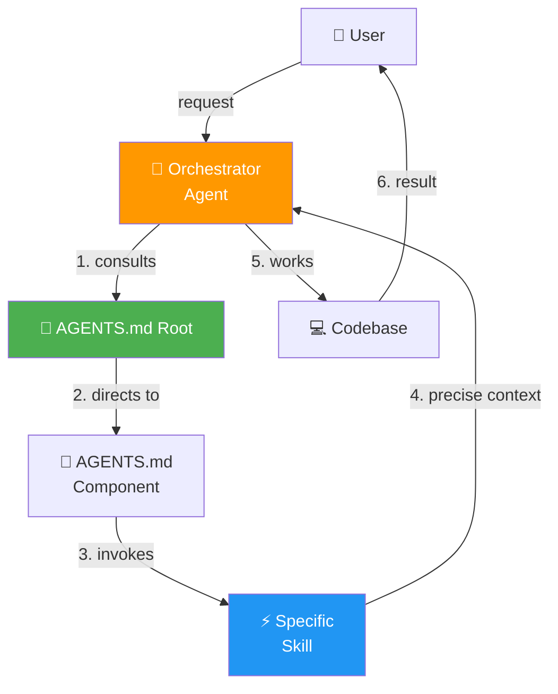
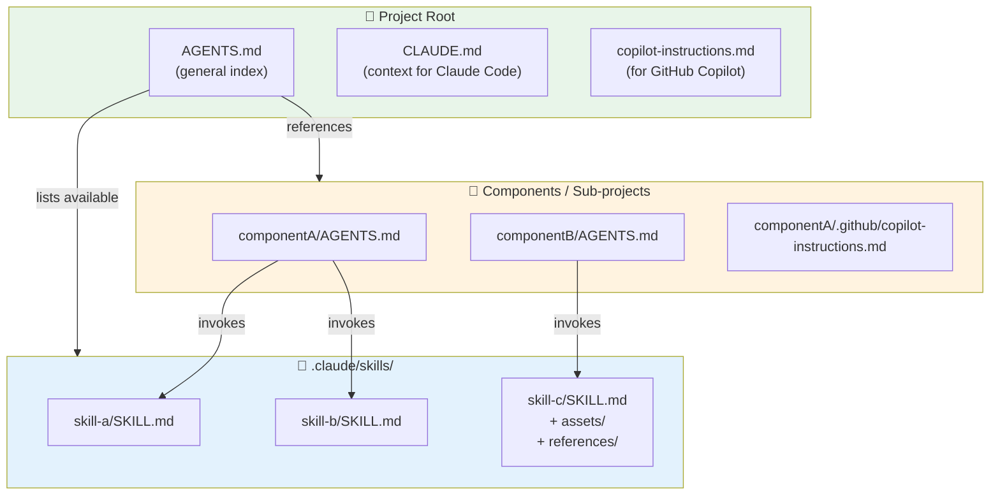
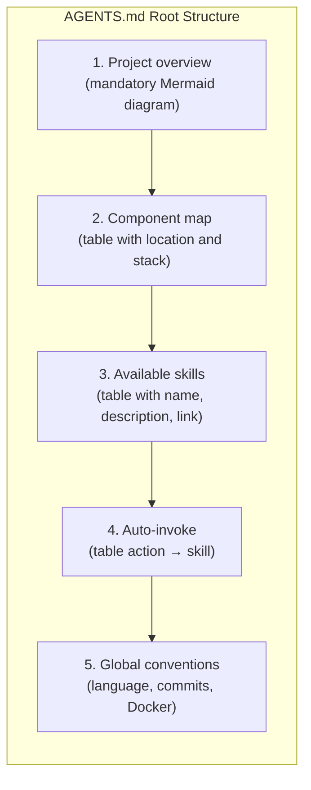
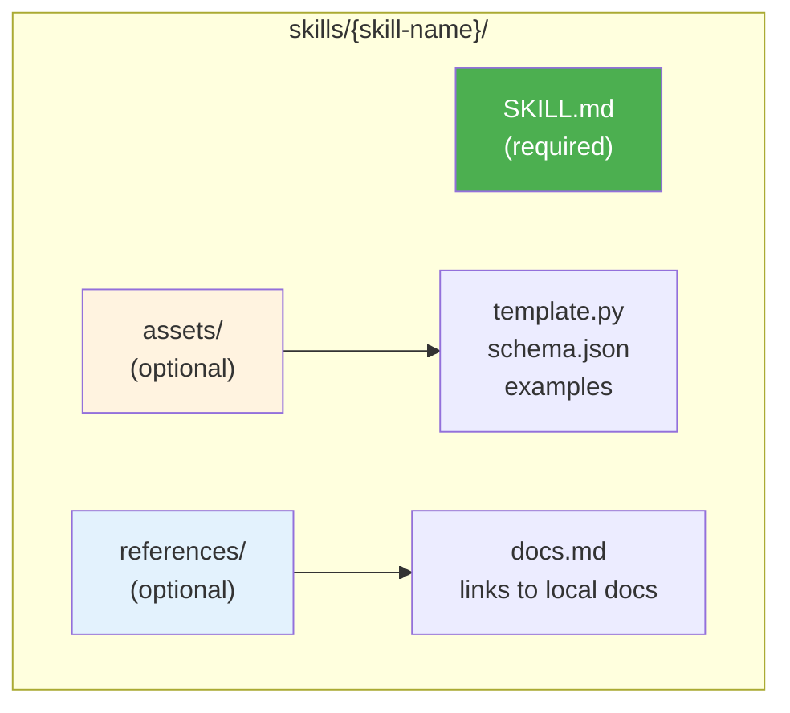
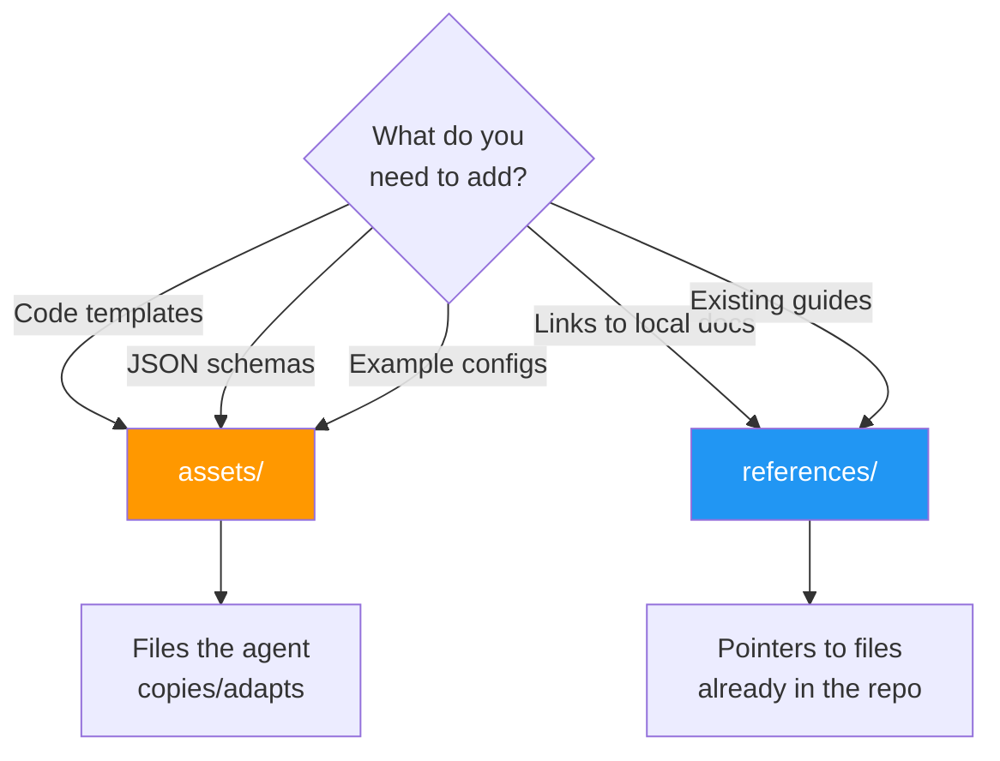
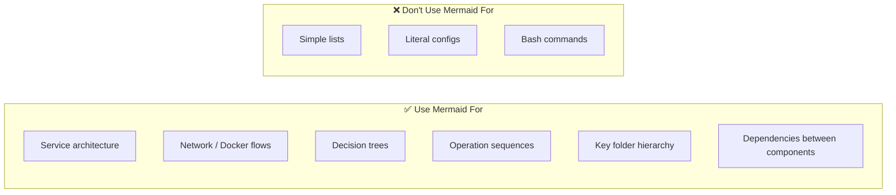
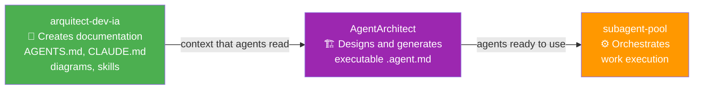
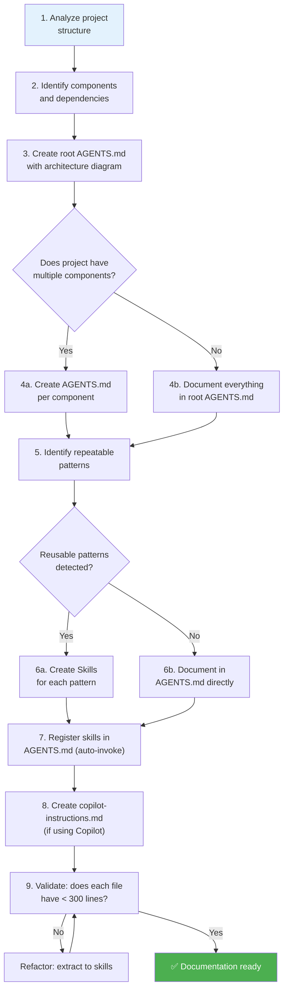

# AI Context Documentation Architect

> Skill for creating and maintaining **context documentation** oriented towards AI agents:
> `AGENTS.md`, `CLAUDE.md`, `copilot-instructions.md`, skills and Mermaid diagrams.
>
> ⚠️ **Scope limit**: This skill does NOT create executable agents (`.agent.md`).
> To design and generate Claude Code agent teams → use **AgentArchitect**.

---

## When to Use

| ✅ This skill | ❌ Use AgentArchitect instead |
|---|---|
| Create/update `AGENTS.md` (root or component) | Create `.agent.md` agents in `.claude/agents/` |
| Create/update `CLAUDE.md` | Design Conductor + specialists teams |
| Create/update `copilot-instructions.md` | Define agent tools and models |
| Create new skills (SKILL.md) | Establish orchestration hierarchy |
| Document architecture with Mermaid diagrams | |
| Structure mono-repo for AI work | |
| Define project conventions and culture | |
| Reduce unnecessary context to avoid hallucinations | |

---

## Core Philosophy



**Key principle**: Less context = less hallucination. The agent should only receive
what it needs, when it needs it.

---

## AI Documentation Architecture

### File Hierarchy



### Size Rule

| File | Recommended Lines | Maximum |
|------|-------------------|---------|
| `AGENTS.md` root | ~150 | 250 |
| `AGENTS.md` component | ~150 | 300 |
| `copilot-instructions.md` | ~100 | 250 |
| `SKILL.md` | ~100 | 300 |

> **If it exceeds the maximum → split into component files or extract to skills.**

---

## Pattern: AGENTS.md Root

The AGENTS.md root is the **entry point** for any agent. It must contain:



### Minimal Template

```markdown
# Project — AGENTS.md

## Overview
<!-- Mermaid architecture diagram -->

## Components
| Component | Location | Stack | AGENTS.md |
|---|---|---|---|

## Available Skills
| Skill | Description | URL |
|---|---|---|

## Auto-invoke Skills
| Action | Skill |
|---|---|

## Conventions
- Language: English
- Commits: conventional-commits
- Everything in Docker
```

---

## Pattern: Skills

### Folder Structure



### Required Frontmatter

```yaml
---
name: skill-name            # lowercase, hyphens
description: >
  What this skill does.
  Trigger: When to invoke it.
license: MIT
metadata:
  author: eliflowi
  version: "1.0"
  scope: [root|ui|api|infra]  # where it applies
  auto_invoke: "Action that triggers this skill"
allowed-tools: Read, Edit, Write, Glob, Grep, Bash
---
```

### Decision: assets/ vs references/



---

## Pattern: Mermaid Diagrams

**Critical rule**: Always prefer Mermaid diagrams over narrative text for:



### Diagram Types by Situation

| Situation | Mermaid Type | Example |
|-----------|-------------|---------|
| Service architecture | `flowchart TB` | Containers, ports, networks |
| Request flow | `sequenceDiagram` | HTTP request → response |
| Decisions | `flowchart TD` with `{}` nodes | Troubleshooting tree |
| Network topology | `flowchart LR` with subgraphs | Docker networks |
| Deploy timeline | `sequenceDiagram` | Deployment steps |
| Data relationships | `erDiagram` | DB models/tables |
| States | `stateDiagram-v2` | Resource lifecycle |

---

## Relationship with AgentArchitect and subagent-pool

This skill produces **context documentation** that executable agents *read*.
The complete cycle is:



- **This skill** → first, so the project is readable by any AI agent
- **AgentArchitect** → when you need to create a team of executable agents
- **subagent-pool** → when the team already exists and there is work to orchestrate

---

## Complete Flow: Create AI Documentation for a Project



---

## Documentation Completeness Checklist

- [ ] `AGENTS.md` root with Mermaid architecture diagram
- [ ] `AGENTS.md` per component (if applicable)
- [ ] Skills for repeatable patterns (commits, PRs, testing, etc.)
- [ ] Auto-invoke table in each `AGENTS.md`
- [ ] `copilot-instructions.md` for Copilot
- [ ] No documentation file exceeds 300 lines
- [ ] All architecture documented with Mermaid diagrams
- [ ] Complete frontmatter in each skill (`name`, `description`, `allowed-tools`, `metadata.scope`)
- [ ] `assets/` with templates and examples when the skill is complex
- [ ] `references/` pointing to local docs (not web URLs)

---

## Useful Commands

```bash
# Count lines in an agent file
wc -l AGENTS.md

# Find all project skills
find . -name "SKILL.md" -type f

# Find all AGENTS.md
find . -name "AGENTS.md" -type f

# Find copilot-instructions
find . -path "*/.github/copilot-instructions.md" -type f

# View skills structure
tree .claude/skills/ 2>/dev/null || find .claude/skills -type f | head -20
```

---

## Anti-patterns

- ❌ `AGENTS.md` of 800+ lines → agent hallucinates
- ❌ Everything in narrative text → ambiguity
- ❌ Skills without frontmatter → won't auto-invoke
- ❌ Duplicate existing docs → gets out of sync
- ❌ Web URLs in references/ → use local paths
- ❌ One giant AGENTS.md → split by component

---

## Resources

- **Templates**: See [assets/](assets/) for AGENTS.md and SKILL.md templates
- **Reference**: See [references/](references/) for the server architecture guide
