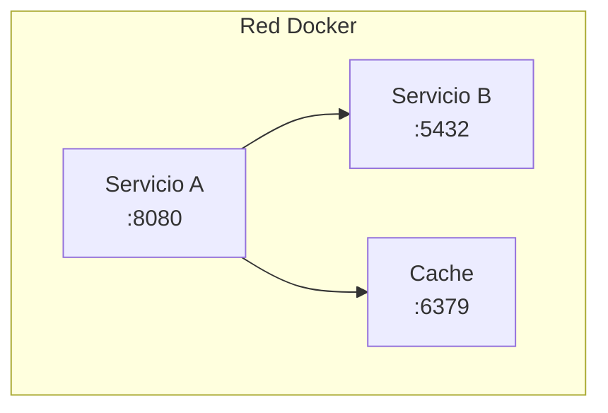
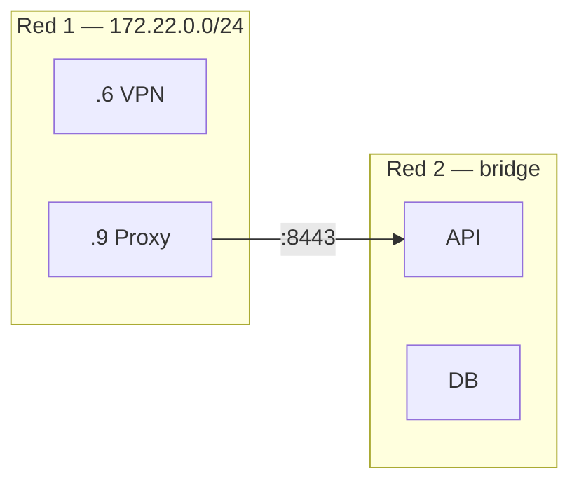
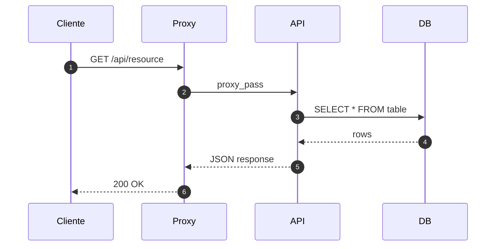
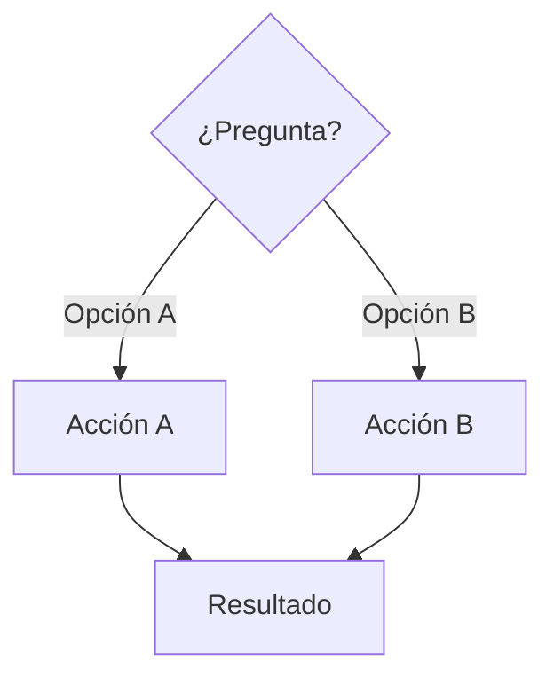
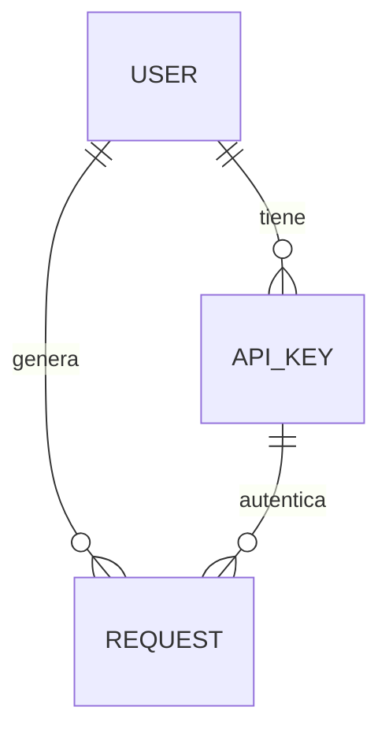
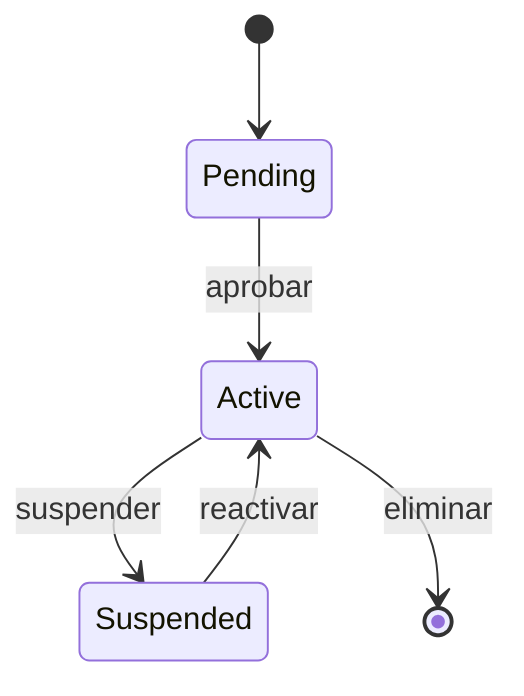
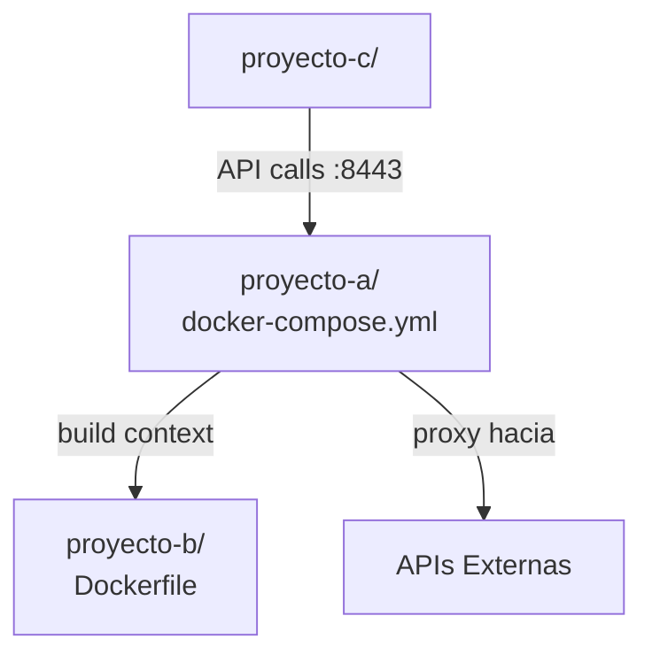

# Catálogo de Diagramas Mermaid para Documentación IA

Referencia rápida de tipos de diagrama y cuándo usarlos.

## Arquitectura de Servicios — `flowchart TB`

Usar para: composición de contenedores, microservicios, componentes principales.

## Topología de Red — `flowchart LR`

Usar para: redes Docker, subnets, conexiones entre redes.

## Flujo de Request — `sequenceDiagram`

Usar para: flujo HTTP, autenticación, interacción entre servicios.

## Árbol de Decisión — `flowchart TD`

Usar para: troubleshooting, flujos condicionales, elecciones de diseño.

## Relaciones de Datos — `erDiagram`

Usar para: modelos de base de datos, relaciones entre entidades.

## Estados — `stateDiagram-v2`

Usar para: ciclo de vida de recursos, estados de un proceso.

## Dependencias entre Proyectos — `flowchart TD`

Usar para: mono-repos, relaciones build/deploy entre componentes.

