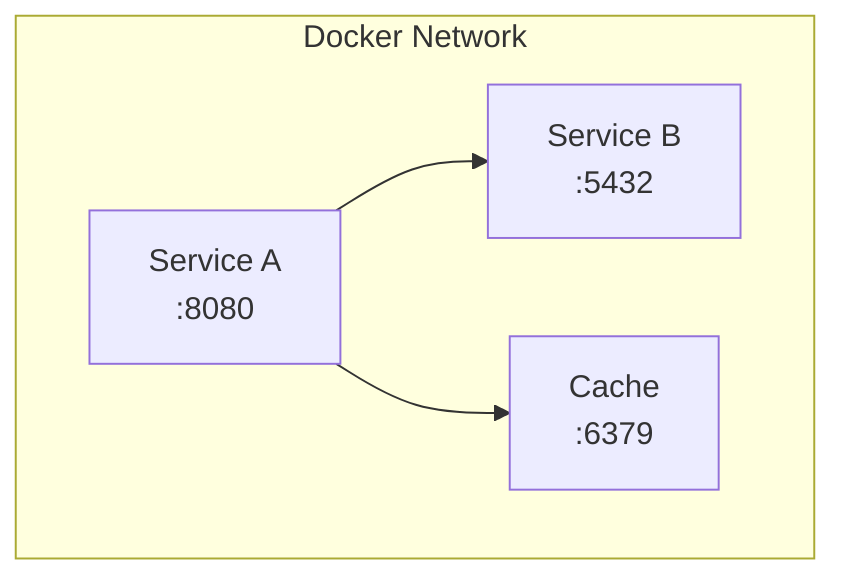
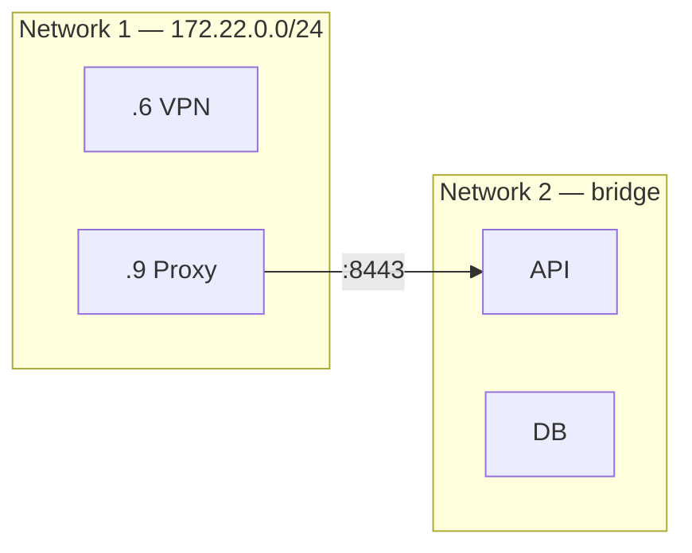
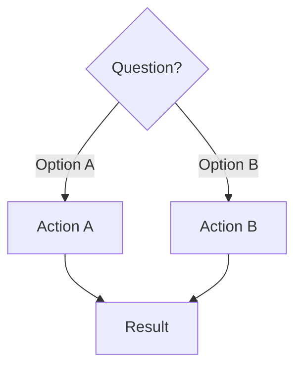
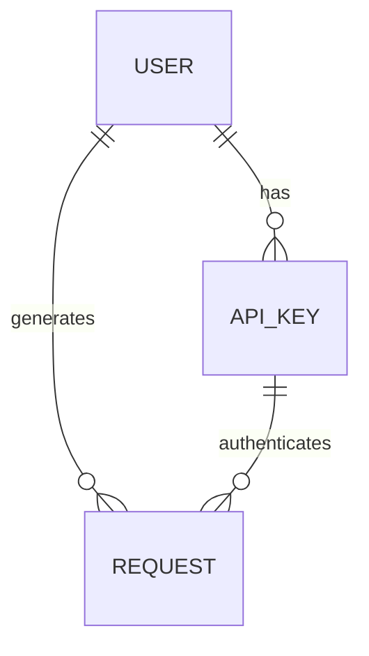
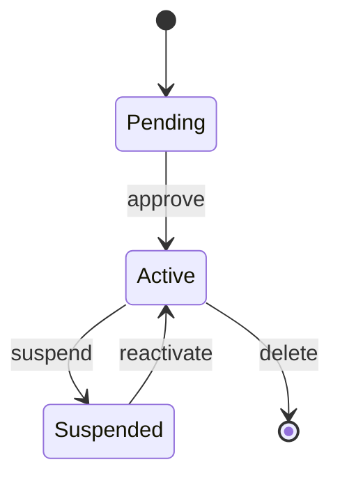
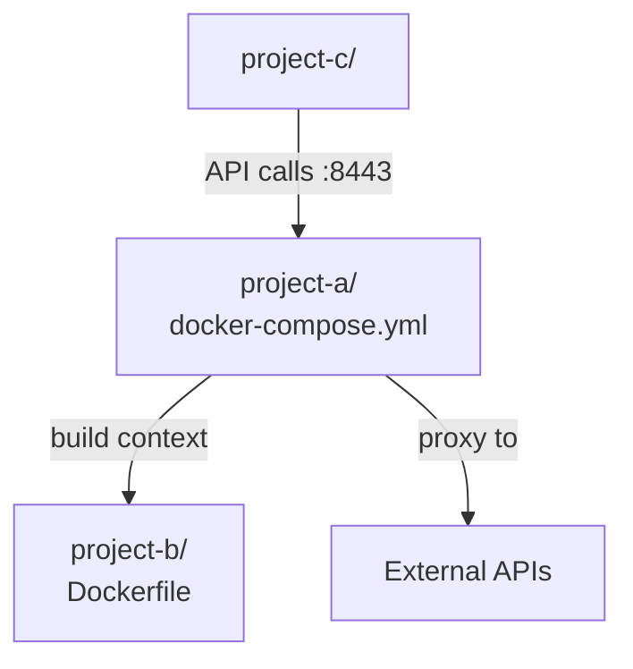

# Mermaid Diagram Catalog for AI Documentation

Quick reference of diagram types and when to use them.

## Service Architecture — `flowchart TB`

Use for: container composition, microservices, main components.

## Network Topology — `flowchart LR`

Use for: Docker networks, subnets, connections between networks.

## Request Flow — `sequenceDiagram`

Use for: HTTP flow, authentication, interaction between services.

## Decision Tree — `flowchart TD`

Use for: troubleshooting, conditional flows, design choices.

## Data Relationships — `erDiagram`

Use for: database models, relationships between entities.

## States — `stateDiagram-v2`

Use for: resource lifecycle, process states.

## Project Dependencies — `flowchart TD`

Use for: mono-repos, build/deploy relationships between components.

