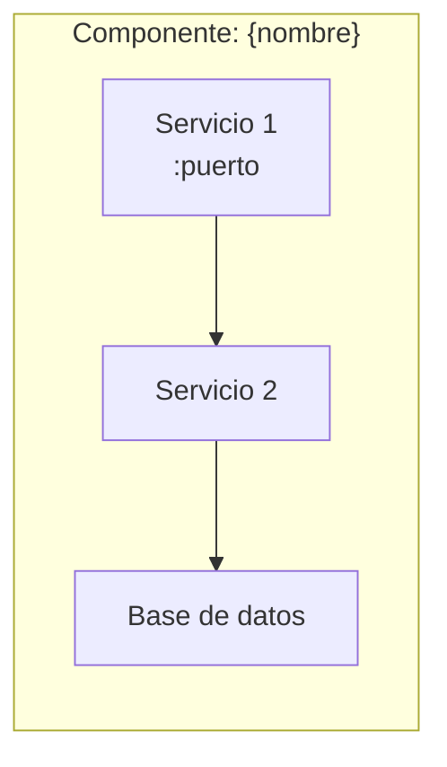
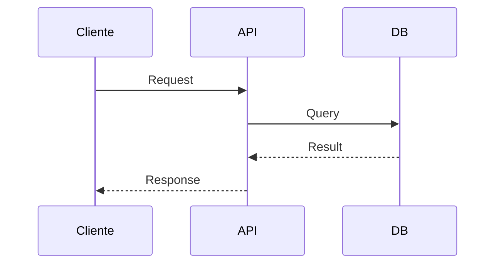

# {Componente} — AGENTS.md

> {Descripción del componente en una línea}

## Arquitectura Interna



## Estructura de Carpetas

```
componente/
├── src/              # Código fuente
│   ├── module_a/     # Descripción
│   └── module_b/     # Descripción
├── tests/            # Tests
├── config/           # Configuración
├── docker-compose.yml
└── Dockerfile
```

## Stack Tecnológico

| Tecnología | Versión | Propósito |
|---|---|---|
| Python | 3.11 | Lenguaje principal |
| Flask/Django | x.x | Framework web |
| PostgreSQL | 16 | Base de datos |

## Patrones Críticos

<!-- Documenta aquí los patrones que el agente DEBE seguir -->

### Patrón: {Nombre}



## Skills Disponibles

| Skill | Descripción | URL |
|---|---|---|
| `skill-name` | Descripción | [SKILL.md](../../skills/skill-name/SKILL.md) |

## Auto-invoke

| Acción | Skill |
|---|---|
| Crear endpoints | `proyecto-api` |
| Escribir tests | `proyecto-test` |

## Comandos

```bash
# Desarrollo local
docker-compose up -d --build

# Logs
docker-compose logs -f {servicio}

# Tests
docker-compose exec {servicio} pytest
```
