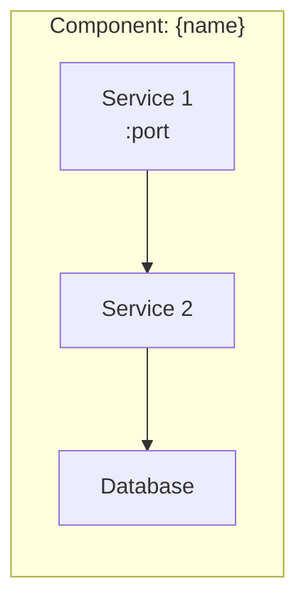
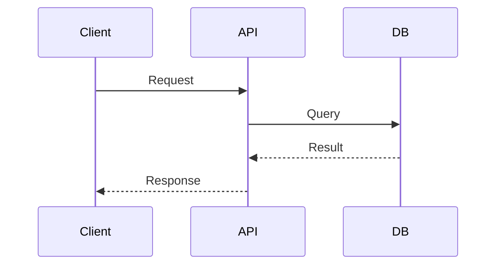

# {Component} — AGENTS.md

> {One-line description of the component}

## Internal Architecture



## Folder Structure

```
component/
├── src/              # Source code
│   ├── module_a/     # Description
│   └── module_b/     # Description
├── tests/            # Tests
├── config/           # Configuration
├── docker-compose.yml
└── Dockerfile
```

## Tech Stack

| Technology | Version | Purpose |
|---|---|---|
| Python | 3.11 | Main language |
| Flask/Django | x.x | Web framework |
| PostgreSQL | 16 | Database |

## Critical Patterns

<!-- Document here the patterns the agent MUST follow -->

### Pattern: {Name}



## Available Skills

| Skill | Description | URL |
|---|---|---|
| `skill-name` | Description | [SKILL.md](../../skills/skill-name/SKILL.md) |

## Auto-invoke

| Action | Skill |
|---|---|
| Create endpoints | `project-api` |
| Write tests | `project-test` |

## Commands

```bash
# Local development
docker-compose up -d --build

# Logs
docker-compose logs -f {service}

# Tests
docker-compose exec {service} pytest
```
