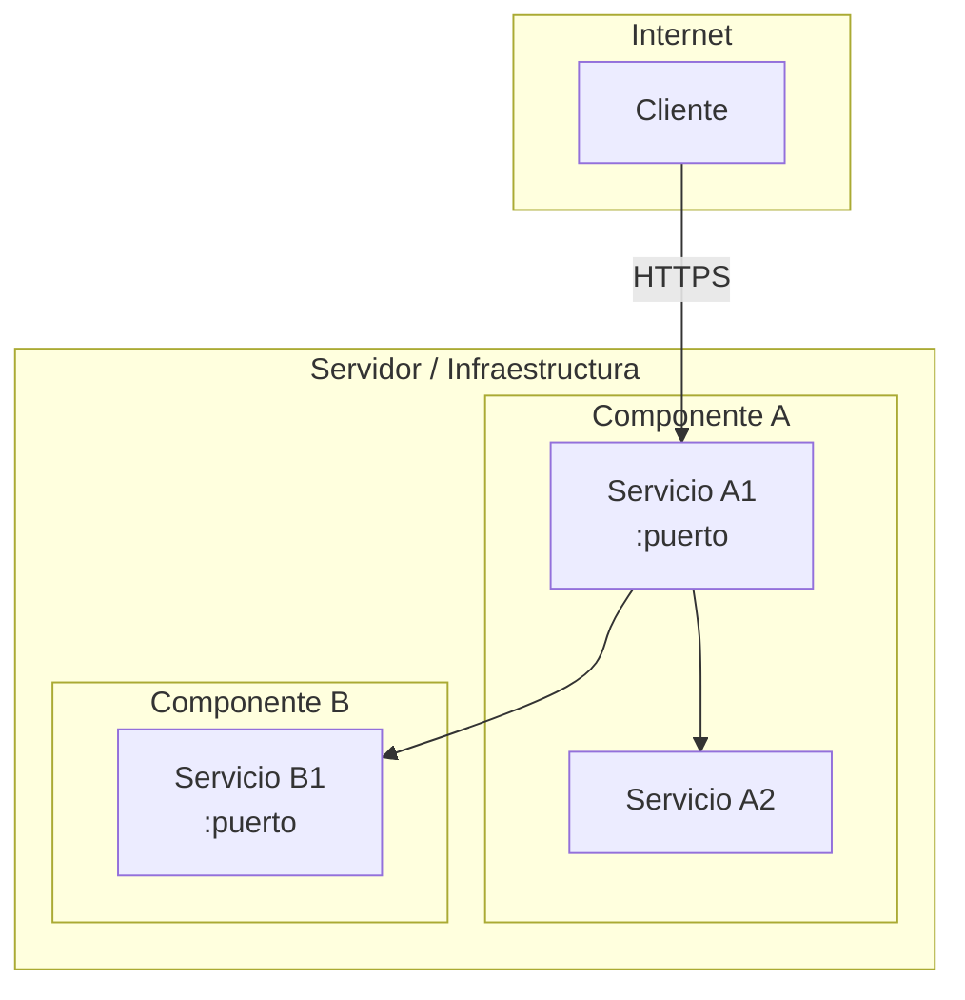
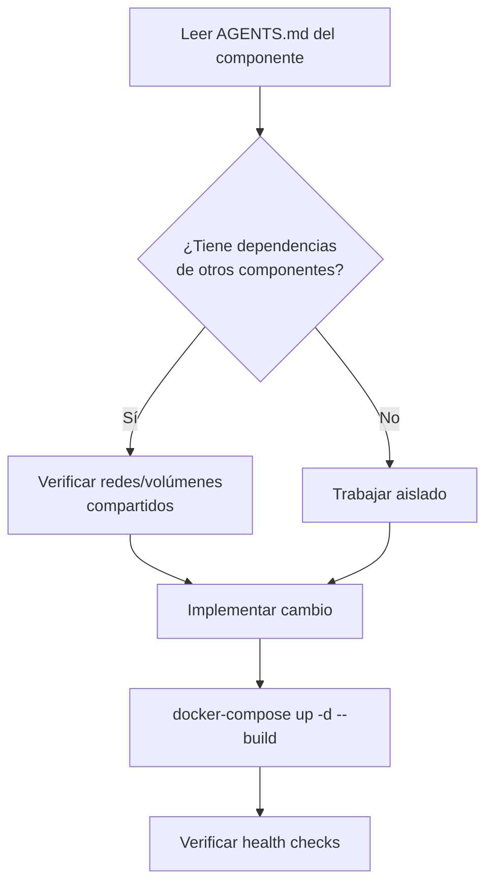

# {Nombre del Proyecto} — AGENTS.md

> {Descripción breve de una línea del proyecto}

## Visión General

<!-- Diagrama de arquitectura obligatorio — Mermaid flowchart TB -->

## Componentes

| Componente | Ubicación | Stack | AGENTS.md |
|---|---|---|---|
| `componente-a/` | Descripción | Tech stack | [AGENTS.md](componente-a/AGENTS.md) |
| `componente-b/` | Descripción | Tech stack | [AGENTS.md](componente-b/AGENTS.md) |

## Skills Disponibles

### Genéricas
| Skill | Descripción | URL |
|---|---|---|
| `nombre-skill` | Qué hace | [SKILL.md](skills/nombre-skill/SKILL.md) |

### Específicas del Proyecto
| Skill | Descripción | URL |
|---|---|---|
| `proyecto-feature` | Qué hace | [SKILL.md](skills/proyecto-feature/SKILL.md) |

## Auto-invoke Skills

Cuando realices estas acciones, SIEMPRE invoca la skill correspondiente PRIMERO:

| Acción | Skill |
|---|---|
| Crear/modificar arquitectura de agentes | `arquitect-dev-ia` |
| Crear nueva skill | `skill-creator` |
| Hacer un commit | `proyecto-commit` |

## Convenciones

- **Idioma**: Español (código, docs, commits)
- **Diagramas**: Mermaid obligatorio para arquitectura y flujos
- **Docker**: Todo en contenedores
- **`.env`**: Nunca en git

## Workflow de Operaciones

