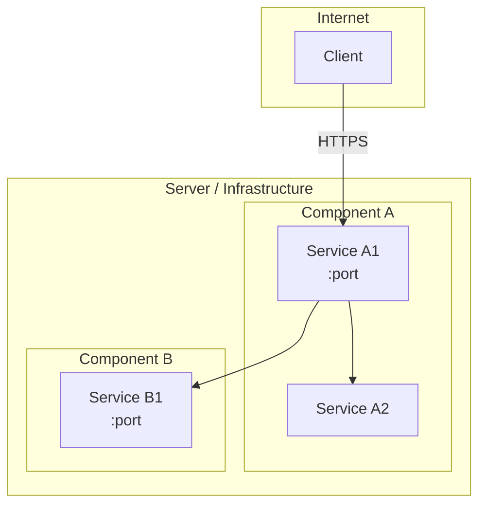
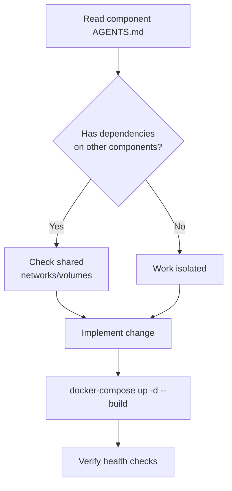

# {Project Name} — AGENTS.md

> {One-line brief description of the project}

## Overview

<!-- Mandatory architecture diagram — Mermaid flowchart TB -->

## Components

| Component | Location | Stack | AGENTS.md |
|---|---|---|---|
| `component-a/` | Description | Tech stack | [AGENTS.md](component-a/AGENTS.md) |
| `component-b/` | Description | Tech stack | [AGENTS.md](component-b/AGENTS.md) |

## Available Skills

### Generic
| Skill | Description | URL |
|---|---|---|
| `skill-name` | What it does | [SKILL.md](skills/skill-name/SKILL.md) |

### Project-Specific
| Skill | Description | URL |
|---|---|---|
| `project-feature` | What it does | [SKILL.md](skills/project-feature/SKILL.md) |

## Auto-invoke Skills

When performing these actions, ALWAYS invoke the corresponding skill FIRST:

| Action | Skill |
|---|---|
| Create/modify agent architecture | `arquitect-dev-ia` |
| Create new skill | `skill-creator` |
| Make a commit | `project-commit` |

## Conventions

- **Language**: English (code, docs, commits)
- **Diagrams**: Mermaid mandatory for architecture and flows
- **Docker**: Everything in containers
- **`.env`**: Never in git

## Operations Workflow

