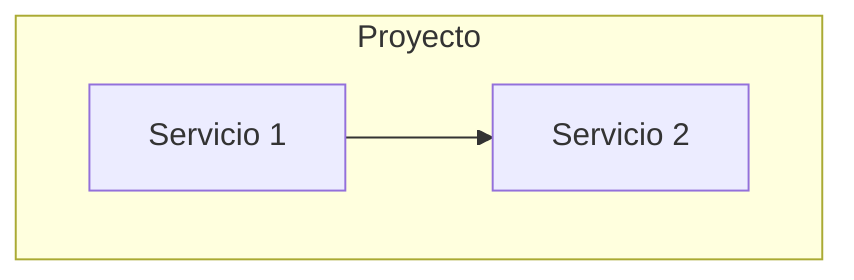

# {Proyecto} — Instrucciones para GitHub Copilot

> {Descripción del proyecto en una línea}

## Arquitectura

<!-- Diagrama Mermaid de la arquitectura del proyecto -->

## Mapa de Componentes

| Directorio | Qué es | Stack |
|---|---|---|
| `componente/` | Descripción | Tech stack |

## Reglas para Agentes

1. **Leer el AGENTS.md o copilot-instructions.md interno antes de trabajar en un componente**
2. **Idioma**: español en todo (docs, código, commits)
3. **Docker siempre**: todo se ejecuta en contenedores
4. **Diagramas Mermaid**: obligatorio para arquitectura y flujos

## Convenciones

- `.env` nunca en git
- Health checks en todos los servicios
- Conventional commits: `<tipo>[scope]: <descripción>`
