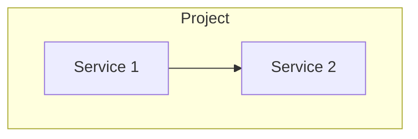

# {Project} — GitHub Copilot Instructions

> {One-line description of the project}

## Architecture

<!-- Mermaid diagram of the project architecture -->

## Component Map

| Directory | What it is | Stack |
|---|---|---|
| `component/` | Description | Tech stack |

## Rules for Agents

1. **Read the AGENTS.md or internal copilot-instructions.md before working on a component**
2. **Language**: English in everything (docs, code, commits)
3. **Docker always**: everything runs in containers
4. **Mermaid diagrams**: mandatory for architecture and flows

## Conventions

- `.env` never in git
- Health checks on all services
- Conventional commits: `<type>[scope]: <description>`
