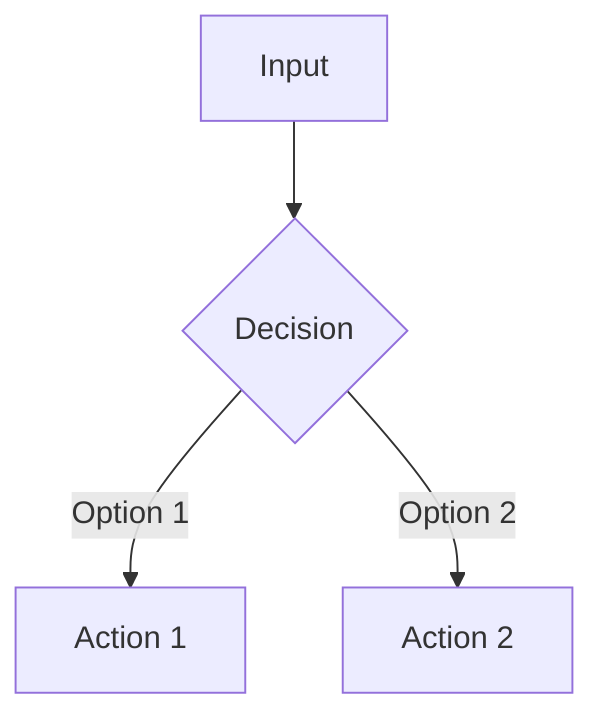

```skill
---
name: {skill-name}
description: >
  {What this skill does in one line}.
  Trigger: {When the agent should invoke this skill}.
license: MIT
metadata:
  author: eliflowi
  version: "1.0"
  scope: [{root|ui|api|infra}]
  auto_invoke: "{Action that triggers this skill}"
allowed-tools: Read, Edit, Write, Glob, Grep, Bash
---

# {Emoji} Skill: {Descriptive Name}

> {Reference documentation or link}

## When to Use

- {Situation 1 where to invoke this skill}
- {Situation 2}
- {Situation 3}

## Critical Patterns

<!-- The most important things the agent MUST know -->



### Rule 1: {Rule Name}

{Brief explanation}

```python
# Code example
```

### Rule 2: {Rule Name}

{Brief explanation}

## Expected Structure

```
folder/
├── file1.py
├── file2.py
└── config/
```

## Commands

```bash
# Useful command 1
command --flag

# Useful command 2
another-command
```

## Resources

- **Templates**: See [assets/](assets/) for {description}
- **Reference**: See [references/](references/) for local docs
```
