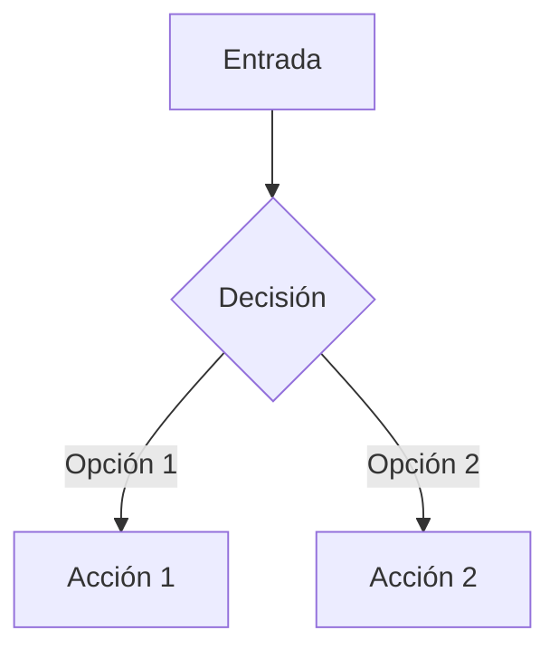

```skill
---
name: {nombre-skill}
description: >
  {Qué hace esta skill en una línea}.
  Trigger: {Cuándo debe el agente invocar esta skill}.
license: MIT
metadata:
  author: eliflowi
  version: "1.0"
  scope: [{root|ui|api|infra}]
  auto_invoke: "{Acción que trigerea esta skill}"
allowed-tools: Read, Edit, Write, Glob, Grep, Bash
---

# {Emoji} Skill: {Nombre Descriptivo}

> {Documentación de referencia o enlace}

## Cuándo Usar

- {Situación 1 donde invocar esta skill}
- {Situación 2}
- {Situación 3}

## Patrones Críticos

<!-- Lo más importante que el agente DEBE saber -->



### Regla 1: {Nombre de la regla}

{Explicación breve}

```python
# Ejemplo de código
```

### Regla 2: {Nombre de la regla}

{Explicación breve}

## Estructura Esperada

```
carpeta/
├── archivo1.py
├── archivo2.py
└── config/
```

## Comandos

```bash
# Comando útil 1
comando --flag

# Comando útil 2
otro-comando
```

## Resources

- **Templates**: Ver [assets/](assets/) para {descripción}
- **Referencia**: Ver [references/](references/) para docs locales
```
