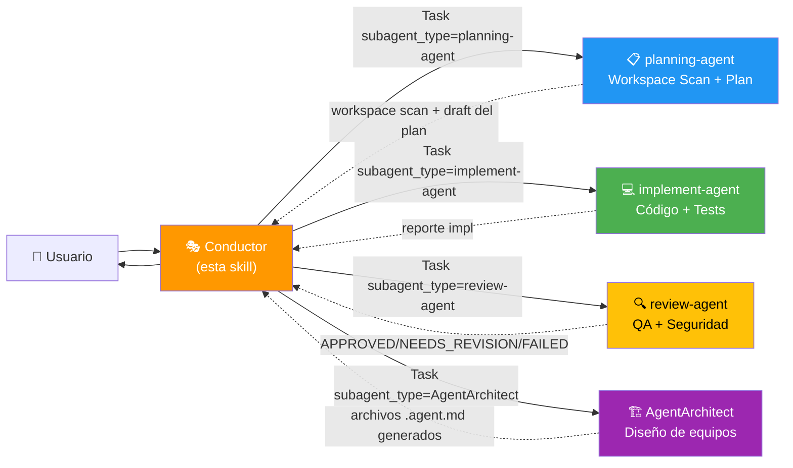

# Agent Definitions & Troubleshooting — v6.0

> Las **definiciones canónicas** de cada agente viven en `.claude/agents/*.agent.md`.
> Este archivo es una **guía rápida + troubleshooting** del pool.

---

## Mapa de Roles



---

## Tabla Resumen

| Agente | `subagent_type` | Modelo | Tools | Modifica código | Firma |
|--------|-----------------|--------|-------|-----------------|-------|
| Conductor (esta skill) | — | **opus** | Task, Write/Edit (solo plans/) | ❌ NUNCA | `🎭 CONDUCTOR ACTIVADO` |
| planning-agent | `planning-agent` | sonnet | Read, Glob, Grep, Bash (graphify + inspección), WebSearch, WebFetch, Write (solo plans/) | ❌ | `🤖 [planning-agent] Investigando...` |
| implement-agent | `implement-agent` | sonnet | Read, Edit, Write, Glob, Grep, Bash | ✅ | `🤖 [implement-agent] Ejecutando Fase {N}...` |
| review-agent | `review-agent` | sonnet | Read, Glob, Grep, Bash (read) | ❌ | `🤖 [review-agent] Revisando Fase {N}...` |
| AgentArchitect | `AgentArchitect` | **opus** | Task, Read, Write, Edit, Glob, Grep, Bash | Solo .agent.md | `🏗️ [AgentArchitect] Diseñando equipo...` |

---

## Reglas de Delegación

| Necesidad | Delegar a |
|-----------|-----------|
| Escanear workspace / detectar convenciones | `planning-agent` |
| Construir/actualizar grafo graphify del proyecto | `planning-agent` |
| Identificar god nodes y dependencias ocultas | `planning-agent` (via graphify) |
| Investigar archivos / patrones del codebase | `planning-agent` |
| Diseñar el plan de fases | `planning-agent` |
| Escribir o editar código del proyecto | `implement-agent` |
| Escribir tests | `implement-agent` |
| Refactorizar | `implement-agent` |
| Verificar calidad / dar APPROVED-NEEDS_REVISION-FAILED | `review-agent` |
| Ejecutar tests para revisar (read-only) | `review-agent` |
| Diseñar un nuevo equipo de agentes desde cero | `AgentArchitect` |
| Generar archivos .agent.md para un nuevo dominio | `AgentArchitect` |

---

## Cuándo usar AgentArchitect vs pool base

| Situación | Usar |
|-----------|------|
| Tarea de desarrollo estándar en proyecto existente | Pool base (planning/implement/review) |
| Tarea compleja con dominio bien definido | Pool base con mini-entrevista |
| Necesitas agentes con prefijo de dominio (multi-orquestación) | `AgentArchitect` primero |
| Sub-dominios claramente separables (frontend/backend) | `AgentArchitect` primero |
| Dominio muy especializado (visión, datos masivos, migración) | `AgentArchitect` primero |

---

## Estructura de archivos del flujo

```
proyecto/
├── plans/
│   ├── {tarea}-plan.md              ← plan aprobado (Conductor)
│   └── {tarea}-complete.md         ← reporte final (Conductor)
├── .claude/
│   ├── agents/
│   │   ├── planning-agent.agent.md
│   │   ├── implement-agent.agent.md
│   │   ├── review-agent.agent.md
│   │   ├── AgentArchitect.agent.md
│   │   └── {Prefix}Conductor.agent.md  ← generado por AgentArchitect (si aplica)
│   └── skills/
│       └── subagent-pool/
│           ├── SKILL.md
│           └── assets/
│               ├── agent-definitions.md    ← este archivo
│               ├── prompts.md
│               └── interview-protocol.md
└── {código del proyecto}
```

---

## 🚨 Troubleshooting

### Síntoma: El subagente no responde con su firma `🤖 [<agent>]`

**Causa probable:** Fallback a `general-purpose` porque no encontró el `subagent_type`.

**Verificar:**
1. `ls .claude/agents/` — ¿existe el archivo `{agent}.agent.md`?
2. ¿El frontmatter tiene `name: {agent}` con nombre EXACTO al `subagent_type`?
3. ¿El `subagent_type` que pasaste a `Task(...)` es exactamente el nombre registrado?

**Reportar al usuario** si no aparece la firma:
```
⚠️ El subagente no se identificó como [{agent}].
Posible fallback a general-purpose. Verifica .claude/agents/.
```

---

### Síntoma: El Conductor está leyendo archivos del repo

**Acción:** Cancelar, mostrar bloque de identidad y delegar a `planning-agent`.

---

### Síntoma: Las convenciones del proyecto no se respetan en la implementación

**Causa:** El Conductor no pasó el workspace scan al implement-agent.

**Acción:** Incluir siempre en el prompt de implement-agent la sección "Convenciones del proyecto" y "Advertencias del grafo" del output de planning-agent.

---

### Síntoma: El implement-agent rompió módulos que no estaban en su scope

**Causa probable:** Tocó un god node sin saber sus dependencias.

**Verificar:**
1. ¿El planning-agent listó ese archivo como god node?
2. ¿El Conductor pasó las "Advertencias del grafo" en el prompt del implement-agent?

**Acción:** Re-delegar a implement-agent con las advertencias del grafo explícitas. Si el grafo no se construyó aún, pedirle al planning-agent que lo construya con `graphify . --no-viz`.

---

### Síntoma: planning-agent tardó mucho en investigar el proyecto

**Causa:** Usó Glob/Grep/Read manual en un proyecto grande cuando debería haber usado graphify.

**Verificar:** ¿El Conductor incluyó el estado de graphify en el prompt del planning-agent?

**Acción:** Para proyectos > 20 archivos, siempre indicar en el prompt: "construir graphify si no existe". El grafo se construye una vez y las consultas posteriores son instantáneas.

---

## Pasos para registrar un nuevo subagente manualmente

1. Crear `.claude/agents/{name}.agent.md` con frontmatter:
   ```yaml
   ---
   name: {name}
   description: '{rol corto}'
   tools: [Read, Edit, ...]
   model: sonnet
   color: {color}
   ---
   ```
2. Cuerpo: rol, restricciones, output format con firma `🤖 [{name}] ...`
3. Agregar fila en la tabla de este archivo
4. Actualizar `agents:` en SKILL.md
5. Probar con un `Task` explícito y verificar que aparezca la firma

> Alternativa: delegar todo a `AgentArchitect`.
