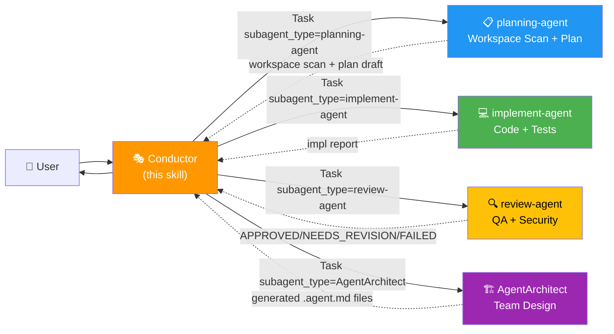

# Agent Definitions & Troubleshooting — v6.0

> The **canonical definitions** of each agent live in `.claude/agents/*.agent.md`.
> This file is a **quick reference + troubleshooting guide** for the pool.

---

## Role Map



---

## Summary Table

| Agent | `subagent_type` | Model | Tools | Modifies code | Signature |
|-------|-----------------|-------|-------|---------------|-----------|
| Conductor (this skill) | — | **opus** | Task, Write/Edit (plans/ only) | ❌ NEVER | `🎭 CONDUCTOR ACTIVATED` |
| planning-agent | `planning-agent` | sonnet | Read, Glob, Grep, Bash (graphify + inspection), WebSearch, WebFetch, Write (plans/ only) | ❌ | `🤖 [planning-agent] Investigating...` |
| implement-agent | `implement-agent` | sonnet | Read, Edit, Write, Glob, Grep, Bash | ✅ | `🤖 [implement-agent] Running Phase {N}...` |
| review-agent | `review-agent` | sonnet | Read, Glob, Grep, Bash (read-only) | ❌ | `🤖 [review-agent] Reviewing Phase {N}...` |
| AgentArchitect | `AgentArchitect` | **opus** | Task, Read, Write, Edit, Glob, Grep, Bash | Only .agent.md | `🏗️ [AgentArchitect] Designing team...` |

> Optional `codex-agent` has no fixed model: `scripts/codex-models.py` resolves the Codex slug per role from `~/.codex/models_cache.json` (latest version per family, 14-day freshness; fallback = Codex default).

---

## Delegation Rules

| Need | Delegate to |
|------|-------------|
| Workspace scan / detect conventions | `planning-agent` |
| Build/update graphify knowledge graph | `planning-agent` |
| Identify god nodes and hidden dependencies | `planning-agent` (via graphify) |
| Investigate files / codebase patterns | `planning-agent` |
| Design the phase plan | `planning-agent` |
| Write or edit project code | `implement-agent` |
| Write tests | `implement-agent` |
| Refactor | `implement-agent` |
| Verify quality / return APPROVED-NEEDS_REVISION-FAILED | `review-agent` |
| Run tests for review (read-only) | `review-agent` |
| Design a new agent team from scratch | `AgentArchitect` |
| Generate .agent.md files for a new domain | `AgentArchitect` |

---

## When to use AgentArchitect vs base pool

| Situation | Use |
|-----------|-----|
| Standard development task on existing project | Base pool (planning/implement/review) |
| Complex task with well-defined domain | Base pool with mini-interview |
| Need domain-prefixed agents (multi-orchestration) | `AgentArchitect` first |
| Clearly separable sub-domains (frontend/backend) | `AgentArchitect` first |
| Highly specialized domain (vision, massive data, migration) | `AgentArchitect` first |

---

## Flow file structure

```
project/
├── plans/
│   ├── {task}-plan.md              ← approved plan (Conductor)
│   └── {task}-complete.md         ← final report (Conductor)
├── .claude/
│   ├── agents/
│   │   ├── planning-agent.agent.md
│   │   ├── implement-agent.agent.md
│   │   ├── review-agent.agent.md
│   │   ├── AgentArchitect.agent.md
│   │   └── {Prefix}Conductor.agent.md  ← generated by AgentArchitect (if applicable)
│   └── skills/
│       └── subagent-pool/
│           ├── SKILL.md
│           └── assets/
│               ├── agent-definitions.md    ← this file
│               ├── prompts.md
│               └── interview-protocol.md
└── {project code}
```

---

## 🚨 Troubleshooting

### Symptom: Subagent doesn't respond with its `🤖 [<agent>]` signature

**Likely cause:** Fallback to `general-purpose` because `subagent_type` was not found.

**Check:**
1. `ls .claude/agents/` — does the file `{agent}.agent.md` exist?
2. Does the frontmatter have `name: {agent}` with the EXACT name matching `subagent_type`?
3. Is the `subagent_type` you passed to `Task(...)` exactly the registered name?

**Report to user** if signature doesn't appear:
```
⚠️ Subagent did not identify as [{agent}].
Possible fallback to general-purpose. Check .claude/agents/.
```

---

### Symptom: Conductor is reading files from the repo

**Action:** Cancel, show identity block and delegate to `planning-agent`.

---

### Symptom: Project conventions are not respected in implementation

**Cause:** Conductor did not pass the workspace scan to implement-agent.

**Action:** Always include a "Project conventions" section and "Graph warnings" from planning-agent's output in the implement-agent prompt.

---

### Symptom: implement-agent broke modules outside its scope

**Likely cause:** Touched a god node without knowing its dependencies.

**Check:**
1. Did planning-agent list that file as a god node?
2. Did the Conductor pass "Graph warnings" in the implement-agent prompt?

**Action:** Re-delegate to implement-agent with explicit graph warnings. If the graph hasn't been built yet, ask planning-agent to build it with `graphify . --no-viz`.

---

### Symptom: planning-agent took too long investigating the project

**Cause:** Used manual Glob/Grep/Read on a large project instead of graphify.

**Check:** Did the Conductor include graphify status in the planning-agent prompt?

**Action:** For projects > 20 files, always indicate in the prompt: "build graphify if it doesn't exist". The graph is built once and subsequent queries are instant.

---

## Steps to manually register a new subagent

1. Create `.claude/agents/{name}.agent.md` with frontmatter:
   ```yaml
   ---
   name: {name}
   description: '{short role}'
   tools: [Read, Edit, ...]
   model: sonnet
   color: {color}
   ---
   ```
2. Body: role, restrictions, output format with signature `🤖 [{name}] ...`
3. Add row to the table in this file
4. Update `agents:` in SKILL.md
5. Test with an explicit `Task` and verify the signature appears

> Alternative: delegate everything to `AgentArchitect`.
