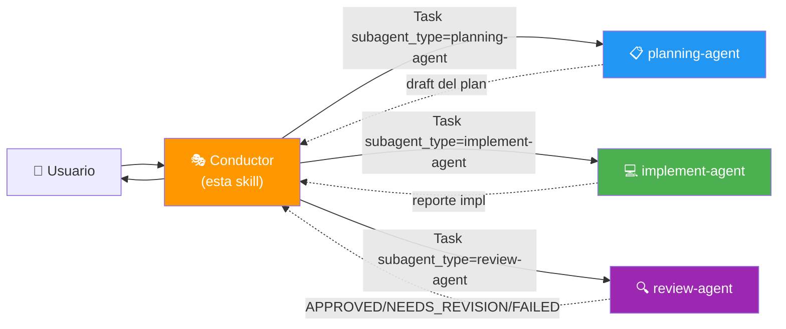

# Agent Definitions & Troubleshooting — v4.0

> Las **definiciones canónicas** de cada agente viven en `.claude/agents/*.agent.md`.
> Este archivo es una **guía rápida + troubleshooting** del pool.

---

## Mapa de Roles



---

## Tabla Resumen

| Agente | `subagent_type` | Tools | Modifica código | Firma de respuesta |
|--------|-----------------|-------|-----------------|---------------------|
| Conductor (esta skill) | — | Task, Write/Edit (sólo en `plans/`) | ❌ NUNCA | `🎭 CONDUCTOR ...` |
| planning-agent | `planning-agent` | Read, Glob, Grep, Bash (read), WebSearch, WebFetch, Write (sólo `plans/`) | ❌ | `🤖 [planning-agent] ...` |
| implement-agent | `implement-agent` | Read, Edit, Write, Glob, Grep, Bash | ✅ | `🤖 [implement-agent] ...` |
| review-agent | `review-agent` | Read, Glob, Grep, Bash (read) | ❌ | `🤖 [review-agent] ...` |

---

## Reglas de Delegación

| Necesidad | Delegar a |
|-----------|-----------|
| Investigar archivos / patrones del codebase | `planning-agent` |
| Diseñar el plan de fases | `planning-agent` |
| Escribir o editar código del proyecto | `implement-agent` |
| Escribir tests | `implement-agent` |
| Refactorizar | `implement-agent` |
| Verificar calidad / dictar APPROVED-NEEDS_REVISION-FAILED | `review-agent` |
| Ejecutar tests para revisar (read-only) | `review-agent` |

---

## 🚨 Troubleshooting

### Síntoma: "El subagente no responde con su firma `🤖 [<agent>]`"

**Causa probable:** El sistema cayó a `general-purpose` porque no encontró el `subagent_type`.

**Verificar:**
1. ¿Existe el archivo `.claude/agents/{agent}.agent.md`? — `ls .claude/agents/`
2. ¿El frontmatter del archivo tiene `name: {agent}`? — debe coincidir EXACTO con `subagent_type`
3. ¿El `subagent_type` que pasaste a `Task(...)` es exactamente `planning-agent`, `implement-agent` o `review-agent`?

**Reportar al usuario** si no aparece la firma, en lugar de continuar:
```
⚠️ El subagente no se identificó como [implement-agent].
Posible fallback a general-purpose. Verifica .claude/agents/.
```

---

### Síntoma: "El Conductor está leyendo archivos del repo"

**Causa:** El Conductor improvisó en lugar de delegar.

**Acción:** Cancela esa acción, muestra el bloque de identidad y delega a `planning-agent`.

---

### Síntoma: "El review-agent está implementando fixes"

**Causa:** El prompt fue ambiguo o el agente se salió de su rol.

**Acción:** Re-delega a `implement-agent` con los issues específicos del review-agent. NUNCA permitas que `review-agent` modifique código.

---

### Síntoma: "El usuario aprobó el plan pero el Conductor no lo escribió a `plans/`"

**Causa:** El Conductor olvidó escribir el plan aprobado.

**Acción:** El Conductor SÍ puede usar `Write` SOLO para archivos en `plans/`. Esto es coordinación, no implementación.

---

## Estructura de archivos del flujo

```
proyecto/
├── plans/
│   ├── {tarea}-draft.md       ← (opcional) draft del planning-agent
│   ├── {tarea}-plan.md        ← plan aprobado (Conductor lo escribe)
│   ├── {tarea}-phase-1-complete.md  ← (opcional) tras cada fase
│   └── {tarea}-complete.md    ← reporte final (Conductor)
├── .claude/
│   ├── agents/
│   │   ├── planning-agent.agent.md
│   │   ├── implement-agent.agent.md
│   │   └── review-agent.agent.md
│   └── skills/
│       └── subagent-pool/
│           ├── SKILL.md
│           └── assets/
│               ├── prompts.md
│               └── agent-definitions.md    ← este archivo
└── {código del proyecto}
```

---

## Pasos para registrar un nuevo subagente

1. Crear `.claude/agents/{name}.agent.md` con frontmatter:
   ```yaml
   ---
   name: {name}
   description: '{rol corto}'
   tools: [Read, Edit, ...]
   ---
   ```
2. Cuerpo del archivo: rol, restricciones, output format con firma `🤖 [{name}] ...`
3. Agregar fila en SKILL.md → tabla "Agentes disponibles"
4. Agregar template de invocación en `prompts.md`
5. Probar con un Task explícito y verificar que la firma aparezca
